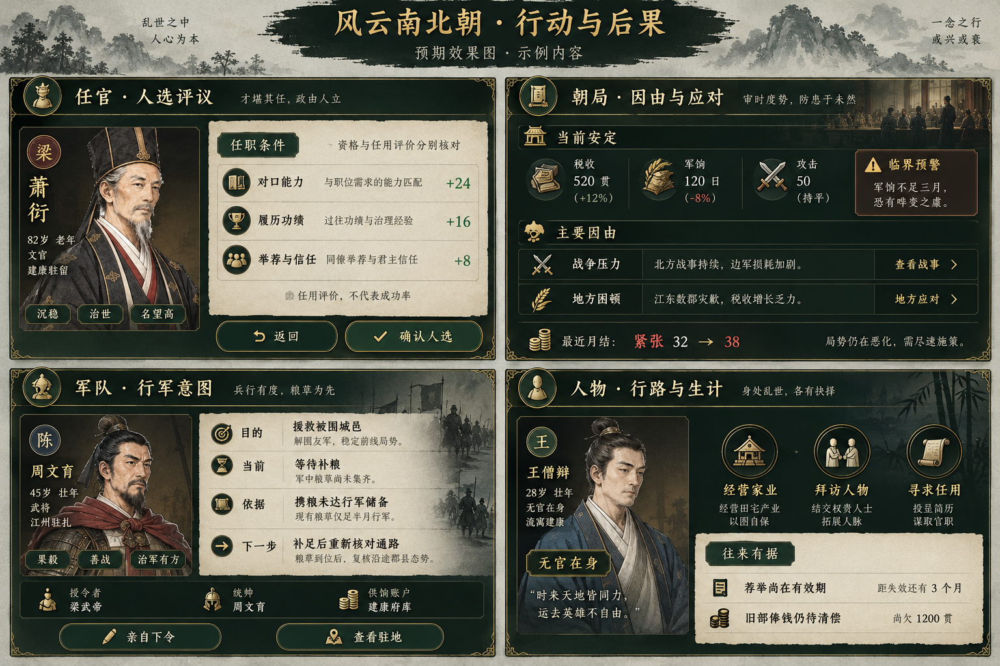

# 行动与后果界面目标

类型：美术目标。范围：任官评议、朝局因由、军队意图、人物生计与往来依据。
状态：2026-10-11 使用内置 imagegen 生成的预期效果图，非实机截图，待用户视觉验收。

实施对齐项：沿用墨绿、旧金、纸色和现有画像；信息以紧凑行列分组；条件与评分分开，行动旁展示依据；确认区常驻。保留现有页面导航、名单及玩法入口，不把四块设计板拼成新的游戏页面。画像及资源使用现有组件，效果图中的人物、故事、数值和装饰不进入结算。

生成方式：内置 imagegen；参考既有 `docs/images/character.png` 的风格。

## 生成提示词

Create a high fidelity Chinese historical strategy RPG UI design board, landscape 3:2, titled 风云南北朝 · 行动与后果, tiny subtitle 预期效果图 · 示例内容. Use attached existing game screenshot ONLY as style reference: dark ink green panels, restrained aged gold borders and ornaments, rice paper content, Song Chinese type, Six Dynasties painted portraits, compact readable controls. This is a NEW UI proposal, NOT a screenshot or replacement painting. Make four clearly separated detailed UI panels in a 2x2 grid with ample readable text; all should be technically implementable with ordinary CSS using existing artwork; no elaborate new 3D decorative assets. Panel 1 任官 · 人选评议: a compact candidate portrait and name on left; right rice-paper panel with green qualification label 任职条件, explanatory text 资格与任用评价分别核对, score factor rows 对口能力 +24, 履历功绩 +16, 举荐与信任 +8; small note 任用评价，不代表成功率; bottom fixed buttons 返回 and 确认人选. Panel 2 朝局 · 因由与应对: ink green, header 当前安定, compact summary 税收 / 军饷 / 攻击, amber note 临界预警, slim labeled cause rows 战争压力 and 地方困顿 with compact 查看战事 and 地方应对 links, recent settlement line 最近月结：紧张 32 → 38. Panel 3 军队 · 行军意图: ink panel with small painted general portrait; 目的 援救被围城邑, 当前 等待补粮, 依据 携粮未达行军储备, 下一步 补足后重新核对通路; a separate small footer 授令者 · 统帅 · 供饷账户 and compact buttons 亲自下令 / 查看驻地. Panel 4 人物 · 行路与生计: ink panel with compact portrait, 无官在身 label, three icon choices 经营家业 / 拜访人物 / 寻求任用; paper strip with title 往来有据 and rows 荐举尚在有效期 / 旧部俸钱仍待清偿. Exact details are illustrative not historical facts. Maintain crisp large simplified Chinese. Avoid modern SaaS cards, gradients, rounded pill overload, dense microscopic print. The design communicates explanations adjacent to existing actions with compact grouped rows and fixed confirmation footer.
