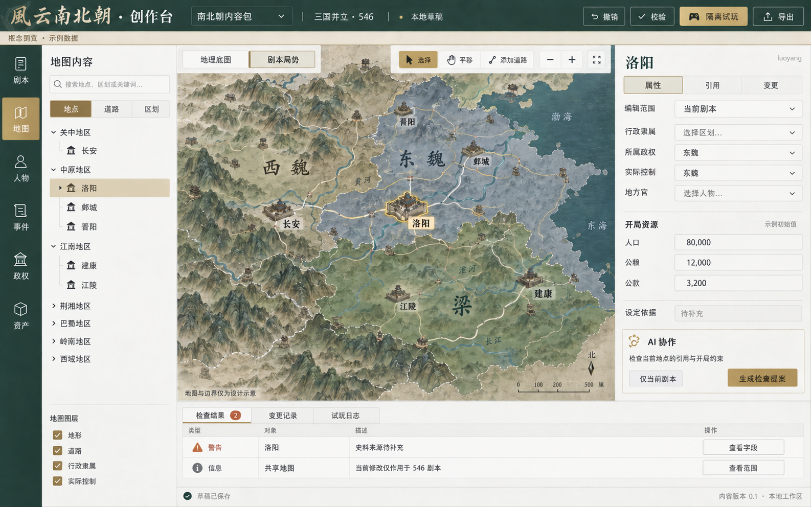
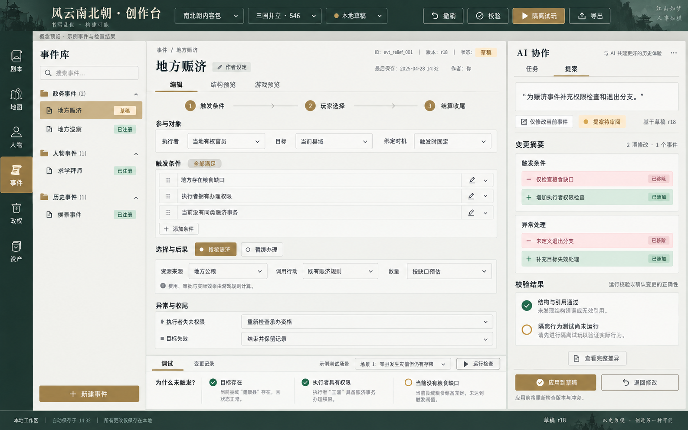
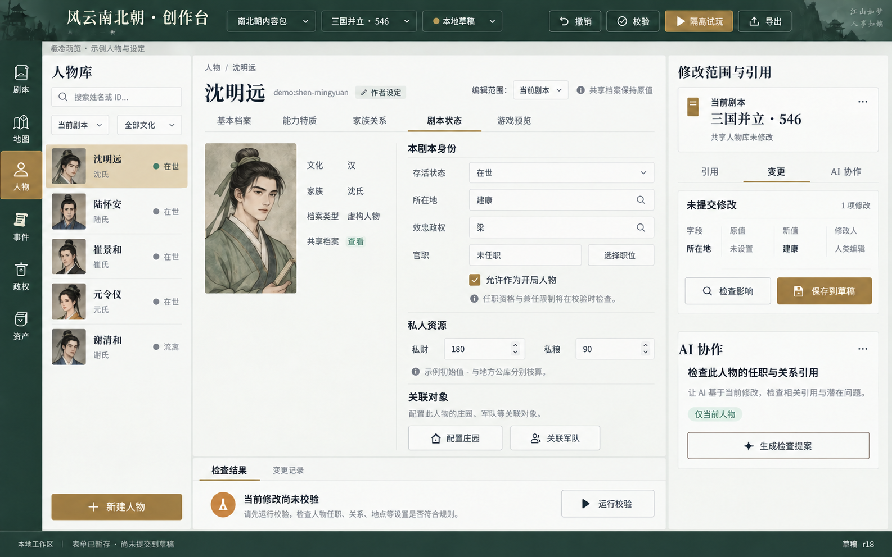
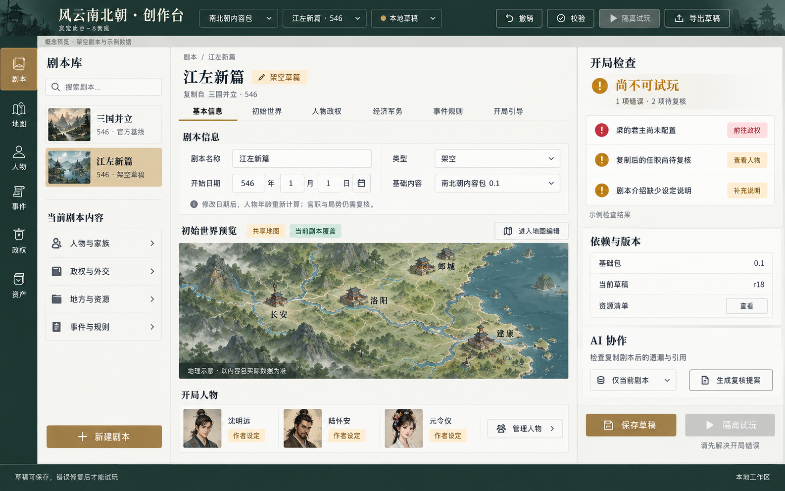

# 内容创作台预期效果图

类型：美术目标与交互设计说明。
范围：地图、事件、人物、剧本四类编辑器，人类编辑及 AI 提案审阅。
状态：2026-10-14 已生成概念图，待用户人工确认；图片不是实机截图或验收证据。图片制作阶段未改游戏代码；后续阶段 2 已实现人物／剧本 UI，入口 `/studio.html`，尚待用户人工验收，实际范围见实施计划第 11 节。地图／事件编辑器尚未实现。
依据：[完整设计方案](../../规划/内容创作台设计方案.md)、[分阶段实施计划](../../规划/内容创作台实施计划.md)，以及当前会话认可的创作台方向。

## 图册

| 画面 | 重点 | 来源 |
| --- | --- | --- |
| [01 地图编辑器](01-map-editor.png) | 地理／剧本局势分离、地点属性、引用与问题定位 | 前轮生成，已修正错误的“齐”标签；本轮复制归档 |
| [02 事件编辑器](02-event-editor.png) | 条件与后果表单、AI 差异审阅、静态与行为验证分开 | 前轮生成；本轮复制归档 |
| [03 人物编辑器](03-character-editor-v2.png) | 共享档案摘要、当前剧本身份、私财、未提交修改与检查 | 本轮新增，第二版校正肖像构图和表单暂存文案 |
| [04 剧本编辑器](04-scenario-editor.png) | 组装开局、日期与依赖、地图预览、错误直达及试玩阻止 | 本轮新增 |

## 01 地图编辑器

左侧对象树定位地点，地图承担空间选择，右侧编辑选中实体，底部检查结果直达字段。切换“地理底图／剧本局势”必须真实改变作用域，不能只切换视觉图层。

地图来自生成示意，不可用于历史疆界、城址、道路或地形数据。三国标签仅表达场景；行政隶属、所属政权、实际控制及其有效日期仍由内容包权威数据决定。示例人口、钱粮不作为数值建议。

## 02 事件编辑器

中间以参与者、条件、选择、后果和收尾组织内容；右侧显示 AI 修改范围、基础修订、字段前后值、校验和应用操作。优先把事件制作及调试做完整，不把拖拽连线作为首期前置。

图中左侧字段与右侧待审提案相同，应在实现中明确标成“提案预览”，并提供切回当前草稿的入口。未应用的内容不得显示为已保存。红绿差异应展示真实字段值，不把摘要“增加权限检查”当成可直接执行的数据。

“地方赈济”是设计示例，具体行动须在能力注册盘点后确认；图上的“既有赈济规则”不证明当前代码已有可直接复用的通用接口。示例检查、人物、日期、版本和调试结果均不是本轮实际验证事实。

## 03 人物编辑器

当前展示“剧本状态”：身份来自共享人物档案，只修改所在地、效忠、职位、可玩资格和私人资源。人物可通过同一档案切换基本资料、能力、家谱和游戏预览。右侧差异显示原值、新值及修改人，检查与保存有不同含义。

沈明远、陆怀安等是作者设定示例，不是新增历史人物；示例能力、资源及肖像均不写入游戏。关联庄园／军队表示进入配置，不代表已经拥有对象。

第二版已缩短肖像框并将底部改为“表单已暂存 · 尚未提交到草稿”。生成图不能作为精确像素尺寸规范，落地时半身像框严格为 2:3、列表为方形，保持实际肖像比例。未提交表单与草稿修订分别标明；默认选项和未知值取真实数据，不照抄图中占位值。

## 04 剧本编辑器

“江左新篇”是复制官方剧本后的架空工作样例。基本信息展示日期与依赖，地图预览直达地理编辑，开局人物直达人物库。右侧把不可试玩的错误与待复核资料分开，点击问题跳到实际对象。

复制一个有效剧本本身不应凭空丢失君主；图中“梁的君主尚未配置”表示作者后续清空字段后的错误状态示例。保存草稿允许保留此状态，试玩和可运行包导出阻止；“导出草稿”仅为明确标记未校验的工作区备份。

地图只作空间预览构图，正式版本复用实际投影和内容数据。日期变化重算年龄，但不推断官职、疆域或外交史实。图中短标题和重复入口可在实现时按实际操作密度收敛，保留错误与禁用原因。

## 共同视觉与交互要求

- 色彩与字体见完整设计方案；标题只保留必要品牌信息，生成图额外出现的装饰性口号不进入正式界面。
- 顶栏固定当前包、剧本、草稿版本、撤销／校验／试玩／导出；不同图中的位置微差在实现时统一为同一外壳。
- AI 是可收起的辅助入口。首期右栏可接收外部工具提案，不要求内置模型聊天；所有基础操作允许人类独立完成。
- 共享定义、当前剧本覆盖、未提交表单、提案预览和编译后快照有明确状态，不能用相同“已保存”笼统描述。
- 绿色结果只代表已执行且绑定当前版本的检查；图片中的通过和警告仅是设计样例。
- 所有数字、人物、地图、版本及元数据仅用于布局，不作为功能已实现或数据已核验的依据。
- UI 由用户人工验收。本轮仅检查生成图的内容和设计表达，未操作浏览器或进行前端 UI 验收。

## 生成记录

工具：内置 `image_gen`，通过 `imagegen` 技能；未使用 CLI/API 回退。人物和剧本图以事件图作视觉参考。最终图片与提示词均保存在此目录。

| 图 | 最终生成提示词 | 补充 |
| --- | --- | --- |
| 地图 | [初始提示词](01-map-editor.prompt.txt) | [定向修正提示词](01-map-editor-correction.prompt.txt)去掉不适用的“齐”示意 |
| 事件 | [提示词](02-event-editor.prompt.txt) | 无输入参考图 |
| 人物 | [初始提示词](03-character-editor.prompt.txt) · [修正提示词](03-character-editor-correction.prompt.txt) | 输入参考：`02-event-editor.png`；初稿为 `03-character-editor.png`，选用图为 `03-character-editor-v2.png` |
| 剧本 | [提示词](04-scenario-editor.prompt.txt) | 输入参考：`02-event-editor.png` |

原始生成文件保留在 Codex 生成目录；本文仅引用仓库内的正式设计副本。原始反例和被替换地图不加入本图册。
