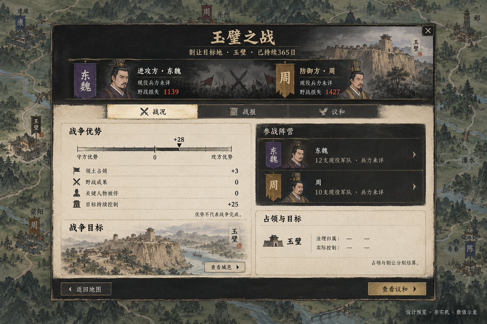

# 弹窗交互与美术重设计

类型：交互评审与美术目标。日期：2026-10-13。
状态：**设计提案，未实施，待用户确认**。本轮没有修改游戏源码、操作存档或进行浏览器验收。
依据：用户提供的战争详情截图、当前 JSX／CSS 及已保存的左侧操作栏目标图。其他弹窗的结论属于代码结构评审，不宣称逐一实机看过。

[打开完整效果图册](index.html) · [生成提示词](prompts.json) · [修订提示词](revision-prompts.json) · [静态入口清单](inventory.json)

## 范围与边界

扫描发现 **72 个 UI 文件中的 151 处弹窗相关 JSX 调用点**，包含公共容器、调用者、嵌套确认及条件分支，不等于 151 个独立弹窗。图册提供 **10 张图、37 个代表性页面状态**；同构业务共用设计模板，不为每个动态标题重复生成图片。下表说明每个入口采用哪个模板或为何保留。

本轮重点是尚未完成独立内容布局重设计的战争、军令、业务操作、事件和系统弹窗。已重构的左侧主页面、人物详情、城市／公库详情、庄园、生活重心和顶部旗帜不推倒重做。已有外交交涉、选人、宣战预览沿用前轮目标；本次只检查共用弹窗样式是否漏接，以及相关确认与记录能否统一。入口所在主页面已重构，不代表其所有二级业务弹窗已完成。

## 评审结论

| 问题 | 证据与影响 | 设计处理 |
| --- | --- | --- |
| 页签布局作用域断开 | `ActionDialog.tsx` 将窗口 portal 到 `document.body`，`detailPanels.css:3–8` 的页签布局却依赖 `.focused-shell`；`WarDetails` 复用 `DetailTabs`，因此截图出现左侧竖排按钮 | 未来将弹窗页签样式归属于弹窗自身，不依赖挂载祖先；战争固定单行战况／战报／议和 |
| 同一身份重复，正文被挤下去 | 外层“战争详情”、内部大横幅、双方摘要、参战阵营再列双方；截图第一屏下方内容被裁 | 单一“玉璧之战”标题；摘要只列阵营、现役情报、损失，成员名单放局部滚动区 |
| 战分长得像任务完成率 | `WarDetails` 用原生 `meter` 显示 -100 到 100，截图为绿色填充条 | 零点居中的双向刻度，明确攻／守方向、总分和分项；战争仍须议和或规则结算 |
| 议和像不断追加的表单 | `WarSettlement` 重复战争摘要，再铺交割、组合条款、多个方案及确认；选择与最终后果距离远 | 左侧条款草稿，右侧常驻和约预览；方案互斥、土地归还独立，底部审阅与签订分别处理 |
| 业务弹窗共用外壳，但没有共同的信息顺序 | `ActionDialog` 只包裹 title/body/footer，内部由各业务自行组织 | 统一“对象与身份 → 方案／参数 → 资源来源和后果 → 执行”的阅读顺序 |
| 说明很长，关键代价藏在文字里 | 宣战、议和、迁运、差事等存在成段条件／结算说明 | 关键钱粮、时间、权限、失去什么常显；详细因子与旧档说明按需查看，不能为了画面删除必要规则 |
| 场景层级混杂 | 操作弹窗、通知、必须裁决的事件、回放记录沿用近似壳体 | 分成案卷查阅、行动文书、事件裁决、纯通知、危险确认五类；分别规定关闭和按钮行为 |
| 只套纸色不能产生沉浸感 | 旧样式包含大面积纸底、重复矩形块、浏览器原生仪表，插画多集中于横幅 | 插画用于人物、城邑、兵种、文书与行动识别；同一墨刷边框、纤维纸、旧金细线、克制朱印 |

## 战争详情的目标结构

- 单层标题：战争名称、目标、持续日数。不再用另一条大横幅重复相同标题。
- 双方摘要：归属旗、真实人物肖像、已知兵力或“未详”、野战损失。统治者不冒充逐军统帅。
- 战况：优势刻度与来源、参战阵营、目标与当前占领；被俘要人、续战意愿、盟军在有实际数据时保留，不因概念图没画而删除。
- 战报：左侧日期／地点记录，右侧选中战报与已结算后果；军队损失和居民损失分开；点击进入原有野战／围城详情。
- 议和：左侧选择方案及县域、受益国、赔款；右侧展示取得、归还、债务／赔款、停战与阻止原因。每个占领县域只有一个“保留割让”勾选，取消表示归还；不允许两个互相冲突的独立勾选。
- 同一场战争从旗帜、军事页、外交页进入，复用同一份内容和草稿逻辑；所在容器可不同，不维护三套布局。
- 战报与围城回放保持原有军阵／部队／战报状态和减少动态能力；展示不推进世界，不改变已结算结果。

## 完整模板与入口映射

以下文件均位于 `src/ui/`。同一文件可能同时包含已改主页面与本轮待改弹窗；范围以“弹窗部分”限定。

| 场景与入口 | 本轮设计 | 效果图 |
| --- | --- | --- |
| `WarDetails`；`MilitaryHub`、`WarDeclaration` 中战争详情 | 一份军议案卷，三页签共享紧凑抬头 | 01、02 |
| `WarSettlement` | 草案和结果并列，最终签约有明确确认；盟军与主导国权限分开 | 02右上、08右下 |
| `CombatDetails`；战役结果记录 | 战阵图服务于军情，军阵／部队／战报沿用现有导航 | 02下排 |
| `RecruitmentPlanDialog`、`ArmyOrganizationPanel` 征募、`MilitaryHub` 私募 | 来源城、兵种、数量、钱粮与训练／集结预览；公军和私募分别标来源 | 03左上 |
| `ArmyDeploymentDialog`、`ArmySupplyStatus` 移驻、`ArmyDock` 军令 | 军队多选、地点、路线和补给后果；遣散另开危险确认 | 03右上、08右下 |
| `MilitaryChoiceDialog` | 单军优先级和指挥方式与国家征粮政策分开；不创造库存 | 03左下、10右下 |
| `MilitaryAftermathPanel`、`CustodyPanel` | 军纪、俘虏／国内拘捕按对象权限列真实选项；重大处置再确认 | 03右下 |
| `RegimentCards`、`CareerSystems` 战役委任 | 兵团详情套战报资料布局；战役委任用军令方案预览 | 02下排、03右上 |
| `ServicePanel`、`OfficialActions`、`CoordinatedServicePanel` | 承办人、辖县、方案、专款和时间同屏预览 | 04左上 |
| `AssignmentPanel`、`DutiesPanel` | 案卷、来往文书、资源和期限各归一处；改派／撤回保留真实后果 | 10左下、08右下 |
| `CourtTreasuryPanel` 拨款／批复／账目、`InkTreasury` 请款／拨付 | 出资方、收款方、审批者与余额清楚；账目／文书共用同一查看器，公库主页面保留 | 04右上、04右下 |
| `PopulationPanel`、`TreasuryPanel` 平粜、`CityManagement` 治理确认 | 人口、粮源、目的地、承载与在途影响；即时小行动用紧凑确认 | 04左下、08右下 |
| `GovernmentAudit` | 记录列表＋证据案卷＋经手／承办人；不把推定当成已查证 | 04右下 |
| `GovernancePolicyPanel`、`GovernmentPanel` 政策／议事、`SituationPanel` 国策 | 同口径比较方案，固定真实收益、代价及审批口径 | 10右下 |
| `UnrestPanel`、`RealmPanel` 地方事件 | 一份诉求、一组可执行方案、一个最终裁决；不可用原因可见 | 10右上、07右上 |
| `PowerPoliticsPanel` 发起／审阅／承诺／迁都／和解／救援 | 共用政治议案文书，替换实际对象和权力变化；保留具体政治条件 | 05左上 |
| `PactRequestPanel` | 归附身份、待遇、义务与承诺并列；申请与接受不混为一键 | 05右上 |
| `PoliticalIdentity` 爵位／议谥 | 册封预览独立于官职任命；议谥保持事件实际要求 | 05左下、09右上 |
| `IntriguePanel` 发起／筹划／撤回 | 对象、参与者、私财、机会、暴露风险；撤回另列沉没成本 | 05右下、08右下 |
| `HouseholdLifePanel`、`HouseholdPlansPanel`；`FamilyMarriagePanel` 草稿 | 家庭关系、照料／培养对象、本人意向和私财；婚配候选器沿用已改选人规范 | 06左上、06左下 |
| `LifeDetails` | 受照料人、办理人、条件和实际费用优先，养护不是装饰卡 | 06左下 |
| `PersonalEconomyPanel` 持家／捐赠、`SocialPanel` 私人安排 | 生活方案统一月度口径，私财与公款分开；不同私人行动替换真实后果 | 06右上、06左上 |
| `RelationshipPanel` 人际行动、`RetinuePanel` 延聘／任职、`ResignationPanel` | 复用已有选人＋对象行动文书，关系影响／月俸／卸任后果显式列出 | 05右上结构、08右下 |
| `MobilityPanel`、`MapPersonPanel` 行粮／通行 | 当前位置、目的地、行粮来源和通行条件；不把确认备粮自动当成启程 | 06右下 |
| `EnterpriseLedger` 承包、`CommercePanel` 商约、`EconomyAction` | 合同、出资账户、交付和退款约定；在途与到账分开 | 10左上 |
| `AppointmentReview`；`OfficeHierarchy`、`LocalAdministration`、`StaffChamber` 任命入口 | 已改候选器保留；批量任命用现任／拟任对照与总后果，不直接铺几十个表单 | 09左上 |
| `PublicSuccessionPanel`、`SocialPanel` 继任／交接 | 君位、执政和家业分开；指定继任与实际交接分开确认 | 09右下结构、09左上 |
| `PauseDialog` 战斗／军务／财政／差事／地方／朝局事件 | 必须裁决没有通用关闭；在原窗裁决或导航到指定操作页，不能“知道了”绕过 | 07上排 |
| `PauseDialog` 效忠／继承事件 | 明确站队与议谥选择，不用普通通知模板 | 09右上、09左下 |
| `PauseDialog` 朝代／抵达／纯通知 | 已结算叙事与后果摘要；唯一确认“知道了”，相关对象可另行查看 | 07下排 |
| `SituationPanel` 原因详情／奏议／起兵、`StaffChamber` 任职文书／官爵 | 原因列表用案卷查看器；政治行动按文书方案；已有朝会场景保留 | 04右下、05左上、10左下 |
| `SaveBrowser`、`App` 菜单／指南 | 存档选择、保存、读取、导入导出职责分离；指南用目录＋正文的案卷阅读布局 | 08上排、04右下结构 |
| `GameAudio` | 山水乐器小插画＋原有音量与重试能力，紧凑独立窗 | 08左下 |
| `ConfirmAction`、`CommandConfirmation` | 单一取消＋明确动作；危险动作朱色、普通动作旧金，费用与对象显式 | 08右下 |
| `ActionDialog`、`DetailSurface` | 公共容器改尺寸档、对比度、页签作用域和局部滚动；按模板覆盖内容，不只套壳 | 全册 |
| `PersonDialog`、`PersonSelection`、`MarriageChoice`、`LifestylePanel` | 已重构，本轮保留主布局／选人／婚配／重心图；仅纳入以后公共样式回归 | 沿用前轮目标 |
| `Development`、`EstateWorkshop`、公库详情 | 已重构营建／庄园／公库保留；通用确认与资金预览随公共规范，经营不新增侧栏 | 沿用前轮目标，确认参照08 |
| `OngoingFlags` | 刚完成的旗帜与聚合清单保留，继续不提供旗帜悬浮提示 | 不重做 |
| `GameEntry`、`CampaignLoading` | 全屏题材开局／载入并非本次旧业务弹窗；保留。新局覆盖确认、存档错误复用紧凑确认／系统反馈 | 08右下结构 |
| `DiplomacyPanel` 交涉、`WarDeclaration` 宣战预览 | 前轮已有独立设计，保留；宣战最终确认统一，战争进行中改用01／02 | 前轮03外交行动图、08右下 |

## 统一的实现规格（待批准）

1. **大小适配内容**：简单确认宽约440–560px，行动预览680–820px，战争／复杂案卷960–1120px，上限为视口减32px。不能把小操作撑成全屏。高度受视口约束，正文局部滚动，标题与最终动作常驻。
2. **字体与现有界面一致**：正文13–14px，辅助11–12px，分组16px，主标题22–26px；标题才使用较强书卷字体，不把全部说明写成大字书法。概念图的缩放不作为CSS像素尺寸。
3. **场景而非巨幅封面**：普通弹窗插画在抬头或对象区，占工作区约15–25%；重大叙事事件可约30%。优先复用现有肖像和城邑美术；缺少的新插画在实施阶段独立出图，不能从整张效果图裁出包含示例文字的背景。
4. **一致的交互部件**：一个克制金色X；单行图标＋短标题页签；选中纸刷、未选墨色；常规按钮约34–40px高。底部一组取消／返回与最终动作；详情导航不是提交按钮。
5. **关闭规则由业务决定**：可取消草稿支持Escape、焦点返回和清理草稿。必须答复的事件不露通用X／知道了；纯通知只保留知道了。不能为了统一外观破坏这个区别。
6. **不嵌套相同选择**：选择人选后返回当前草稿；同一方案不在后续页再选一次。一般动作在自身弹窗预览后确认，重大不可逆行为才追加简洁确认，不层层打开相同表单。
7. **方案同口径比较**：实际收益、一次成本、持续成本、时间／期限、风险分开。单选有真实单选状态；禁用但可发现，原因在当前面板可读。等待审批不画虚假的完成进度。
8. **信息保真**：归属、公私账户、兵力可见性、实际占领、法理和战争范围沿用权威世界；记录缺失显示未详。接受度不改名成功率，国家政策不混成单军命令；朝代变更不凭装饰图扣钱粮。
9. **视觉合并，状态不混并**：征募／私募复用同模板但保留不同钱包；公库与私人账本共享阅读方式不合并余额；战争各入口共享内容；家庭／健康可复用照料布局但保留不同权限；事件中的导航不代替最终裁决。
10. **响应式与可访问性**：双列收为单列时对象摘要优先、确认仍可见；不靠缩小字体装下长名单。键盘焦点、可访问名称、错误提示及真正禁用状态均保留。

## 效果图使用边界

这些是内置 imagegen 生成的美术构图，不是可执行界面或历史资料。生成的地图、人物脸、旗号、日期、单位、数量和小字都可能有误。**不把图中文字、虚构因子、比例或承诺作为新增游戏机制。**正式实现使用已有肖像与真实数据；审批人按权限推导，不能因为图中出现“更换”便增加选择审批人的能力。

已对战争阵营、单军军需和朝代钱粮交接进行生成修订，修订前原稿另存 `drafts/`。仍需以文字规范纠正的细节：02图议和有多余“归还”框，实际只用单个保留割让勾选；02中“约过半”等细字不能取代真实围城进度；07军报示意卡的强调不是已执行或已选方案。08存档示意条目不代表新增多个手动槽；维持现有手动／自动／备份权限与结构。效果图不作为历史考据来源。

## 后续落地顺序与验证边界

确认设计后先落地战争详情与公共页签作用域，再覆盖行动预览／记录模板、裁决事件和系统窗口。每批核对具体组件里的主操作、辅助操作、关闭／取消、选人返回与错误状态，不能只覆盖外层背景。

本轮只新增设计资产、静态图册和评审记录，因此未运行游戏构建／规则测试，也未声称浏览器视觉验收。交付检查覆盖图片可读性、文件存在、图册链接、入口清单映射与Git差异；未来实施再执行直接受影响的局部测试和构建。

交付检查已通过：10张最终图与3张修订前原稿的哈希及1536×1024尺寸、HTML／评审图片链接、151处调用点分类、10条完整生成提示词；本地图册HTTP返回200。用户原截图以 `war-user-reference.png` 原样保留。
