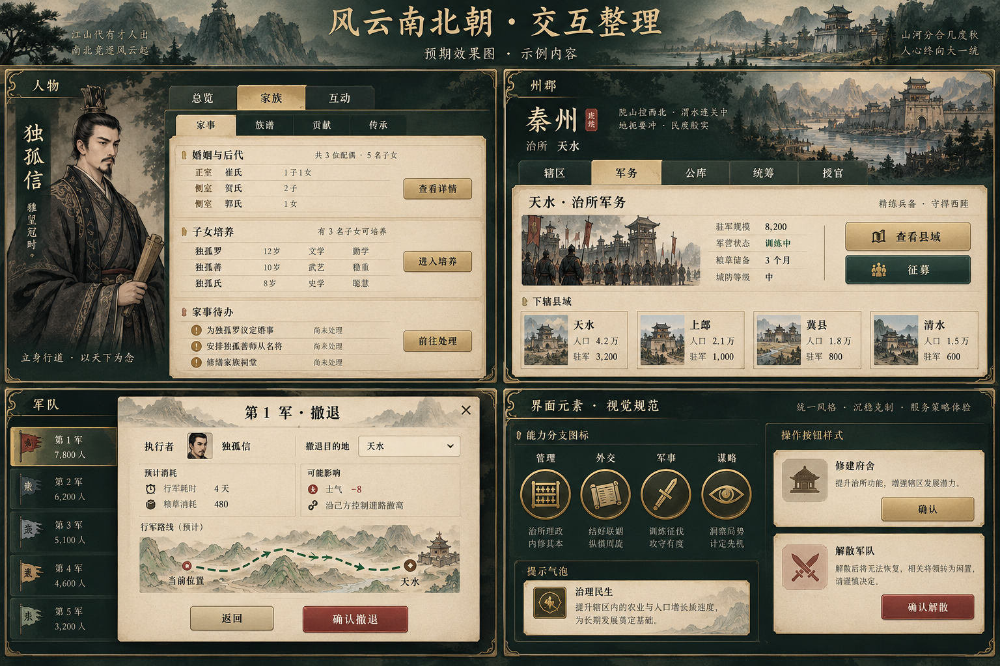

# 全游戏交互修复预期效果

类型：布局与美术参考。范围：人物家事、州郡治所军务、撤退预览、技能及通用行动。
状态：2026-10-11 用户已确认“布局可以，视觉尽量贴近现有界面”；正式界面待人工验收。

图由内置 imagegen 生成，用于修复前对齐紧凑身份摘要、单层页签、独立行动预览与底部确认区。四块画面是分场景设计板，不拼成新的游戏页面。图中人物关系、地点、资源与数值均为示例，不作为历史或游戏数据。

实施沿用现有窗口、墨绿／旧金／纸色、人物画像、横幅和图标体系；按用户反馈保留现有美术，不将生成图的新装饰作为替换资产。技能小图标统一到已有线刻印章样式。与目标图的对应及本次修复范围见[前端交互审查](../规划/前端交互审查.md)。布局确认不代替正式界面视觉验收。
