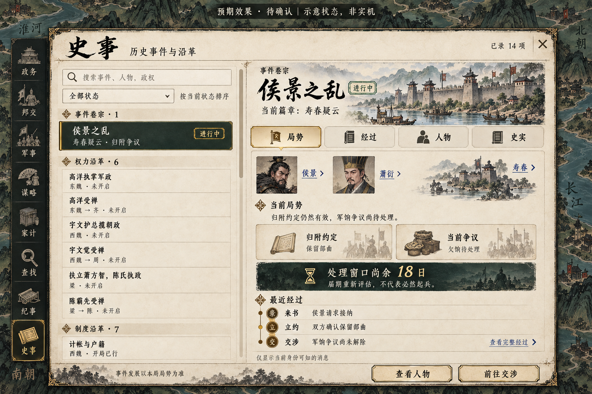

# 侯景之乱与健康提醒美术目标

类型：预期效果图与交互目标。状态：**已获用户确认并本地实施；以下仍是预期效果图，非实机。界面待用户人工验收**。
范围：纳降裁决、事件卷宗／围城、人物健康／病榻议事。日期：2026-10-14。
第 04 项已获本轮用户批准实施，入口由「事件」改名为「事件」；现已本地实现，待用户人工验收。
规则和实施边界以 [落地方案](../../规划/侯景之乱与人物生命周期落地方案.md) 为准。

## 01 河南来书

重点确认纸面与墨绿后果框、三方案单选、人物与真实驻地、固定裁决区。当前画面展示“按原请求保留部曲”；改选后按钮必须变成“发出还价”，由对方确认后才执行。图中 100 钱来自现有接纳预算，实际预览仍须重算；兵数不能从图中猜测。

## 02 危机卷宗和围城

左为当前争议与已经发生的经过，右为地方官查看公开围城军报。18 日、时间线日期、军情及人物状态是排版示例，不作为剧情条件或固定开局数据。筹饷、重议、调军、接济打开实际行动弹窗，不能直接结算。军粮接济仅同地真实移交或走现有运输，不能远程瞬移。

顶部旗帜实际接入既有固定宽度事项区，不采用图中靠左的独立悬浮位置。战争阶段复用既有战争旗帜，防止同一围城挂两面旗。

## 03 身体与安排

左为人物健康区域的局部重排目标，并非删去现有人物身份、能力、特质和其他页签。年龄、健康、病情、照料分别表达；萧衍卡片是同布局的另一状态示例，正式高欢窗口不放无关人物的健康卡。

右为玩家扮演实际执政者时的待决。“准备军政交接”只导航到真实朝廷安排，完成合法命令前仍未交权。若不符合权限，不出现可以直接执行的交接按钮。

## 04 事件总览（已本地实施，待人工验收）

目标：从固定入口查到已录历史内容，包括尚未发生的条目；查看每项在本局的状态、已知信息和可办理入口。使用 frontend-design 与内置 image_gen；[完整生成提示词](04-history-browser-prompt.txt)。图片是美术目标，不是实机截图，也不代表前端已验收。

### 入口与目录

- 左侧主要功能栏在「纪事」之后增加「事件」，使用书册图标与旧金选中态。纪事保留日常记录；原事件卡及顶部事项旗帜直达同一事件条目，不另建平行卷宗。
- 打开时暂停游戏，关闭保持暂停；不得通过查看目录跳过待决弹窗。关闭支持 Escape、焦点返回；目录与详情分别滚动，标题、页签及底部操作常驻。
- 左侧约占三分之一，搜索名称、关联人物及政权；状态筛选使用一个选择框，目录按类型分组。组内优先待本人办理、进行中，再列未开启与既往条目。切换条目保持搜索与滚动位置，不执行选择或裁决。
- 当前核对到 14 项历史题材定义：`historicalEvents.ts` 的侯景事件链 1 项；`governments.ts` 的权力沿革 6 项、制度沿革 7 项。后两类保留类型标签，不称为独立剧情链；制度深化中的模拟设计也须在详情中明确。图中只显示部分目录，其余通过局部滚动查看。
- 14 是当前内容定义数量，不是本局已触发事件数；实际数量随定义变动。日常纪事、通用随机政务、所有人的普通婚育与疾病不混入此目录；病榻议事作为侯景卷宗内实际节点显示。

### 状态与信息

| 状态 | 展示口径 |
| --- | --- |
| 未开启 | 事件尚未启动，或沿革尚不具备办理条件；列当前可知的未满足条件，不承诺日期到来就触发 |
| 可办理 | 对当前人物调用真实资格规则后可以提出该沿革；不等于其他人物不能办理，也不等于已启动 |
| 进行中 | 真实事件、交涉、议案或改革任务存在；另标当前篇章，需本人决策时加「待你办理」 |
| 已结束 | 有真实结果或完成记录，展示结果与已记录日期；侯景事件后续重新开启时同步回到进行中 |
| 已中止 | 有明确终止记录及原因；不把暂时条件不足判为中止 |
| 开局已行 | 剧本初始即成立的制度，不能冒充玩家本局完成 |
| 本局不适用 | 模式、剧本或实际政权等明确排除该条目；说明原因并保留目录位置 |
| 消息未明 | 存在信息权限限制，无法向当前人物披露进展；不能将其标成未开启或暴露私下交涉 |

状态由已有世界数据投影，不另存一份会漂移的事件状态。目录公开内容定义名称；发生时间、阶段、条件中的私人事实、经过与待决内容继续服从当前人物的信息权限。史实年代只在史实页展示，与本局办理门槛和实际发生日期分别标注。历史议案是否已经完成，以可追溯的历史方案关联和实际权力／国统记录判断；不能只看同名国号或某人当前在位推断。

### 详情与动作

- 固定目录名「侯景之乱」，其下显示当前篇章「寿春疑云」等真实标题，避免阶段切换后玩家找不到同一事件。插画占浅标题横幅，人物用小型可点击肖像，地点可直达地图。
- 单层「局势／经过／人物／史实」页签。局势：状态、当前事实、约定或办理条件、实际期限／阻碍、最近经过；经过：仅已发生且当前身份可知的节点；人物：关联身份和对象入口；史实：独立历史参照、来源及模拟边界，不预告本局必然结局。
- 侯景事件显示现有约定、真实争议和处理窗口；权力沿革显示当前安排、合法候选与公开前提；制度沿革显示实施状态、真实任务进度、成本与效果。无任务不显示进度，无期限不显示倒计时。
- 底部按条目与权限显示「前往交涉／前往朝廷／查看制度／查看战况」等导航动作，进入已有办理界面；浏览列表或切页签不执行任何游戏命令。人物已有明确对象入口时，正式布局优先保留这些入口，图中通用「查看人物」按钮可省去重复。
- 事件统一承载浏览详情，裁决继续使用现有行动弹窗；处理后返回原条目并刷新状态。行动禁用时明确原因，不能因为目录公开而获得额外裁决权。

图中侯景与萧衍、寿春争议、其他条目未开启及 18 日期限均属于示意情境。正式显示读取本局人物、地点与记录，画像复用已有资产；图外地图和其他菜单的画法不是本次重做范围。既有存档缺少沿革的完整过程时说明「未记录更早经过」，不补造发生日期或历史。

实施入口：左侧「事件」及既有纪事卡、事项旗帜 → `EventBrowser.tsx`；`eventCatalog.ts` 从真实状态只读生成 14 项目录，浏览不新建事件、不改存档、不执行裁决。制度与权力沿革导航保留所选议案草稿；侯景处置复用现有弹窗，返回时保留列表与筛选。目录中的未知消息不带私下期限、地点或阶段；他国未公开议案不提供办理入口。地图中的成都／江陵历史控制证据是独立史料参照，不是已实现的可执行事件链，本次不伪造其本局状态。

本轮 10 项目录专项、25 项侯景事件规则检查、TypeScript／生产构建与 854 项地图资源校验通过。数值声明清单重建为 859 项；新增声明均是只读显示投影，没有新玩法数值。未运行浏览器自动化、截图比对、全量游戏回归或长局测试。图中的「史事」为原审批图用词，实际入口、标题与返回文案均为「事件」。

人工验收：[本地入口](http://127.0.0.1:5173/) → 进入游戏 → 左侧「事件」。检查目录与详情局部滚动、搜索／筛选、四个页签、不同身份的信息限制、办理后返回以及 Escape／焦点。可沿用下方四份侯景测试存档；开局执政者可检查本国制度与沿革。

## 复用与排除

- 延续现有墨刷、纸色、旧金、线描淡彩风格；实际肖像沿用现有生成与遗传系统，图中人物仅示意，不能替换正式角色资产。
- 图外地图、左侧菜单、装饰文句、地名位置不是地图或导航重做提案；背景沿现有 Three.js 地图，地图地理与人物身份由真实状态提供。
- 生成图片不是可逐字迁入的规则资料。标题与控件中文须由正式文本渲染；新图饰不成为额外玩法数据。
- 战后复用卷宗“经过”布局，加真实结果与善后入口；康复复用纯通知模板。待决不放“知道了”，纯通知不塞虚假选择。
- 重点检查：人物／地点入口、单选与焦点、禁用原因、暗底对比度、滚动内容及常驻确认、跨身份内容和草稿作废。

## 生成记录

使用内置 image_gen，未使用 CLI。原始三组提示词和定向修订存于 [prompts.json](prompts.json)。保留选定图在本目录，未修改游戏运行资产。

本次只检查目标图与方案的一致性；最终视觉效果和实施后的前端均由用户人工验收。

## 本地实施入口

来书与事件纪事使用 `src/ui/HistoricalEvent.tsx`；年龄、病情、照料及继任入口使用 `LifeDetails.tsx` 和既有人物窗口。沿用现有真实肖像、横幅插画、宣纸和墨绿后果区，不把效果图当整张游戏界面，也不复制图中示例兵数／日期。正文局部滚动，裁决区常驻。

在本地游戏的「行记 → 导入」可载入 `.cache/hou-jing/01-河南来书.json`、`02-归附争议.json`、`03-病榻议事.json`、`04-建康围城.json`；这些是单独的人工验收情境。围城从纪事进入事件，再进入实际战况／军队。尚未进行 UI 自动化或人工替代验收，需用户检查布局、美术、文字对比度与操作手感。
