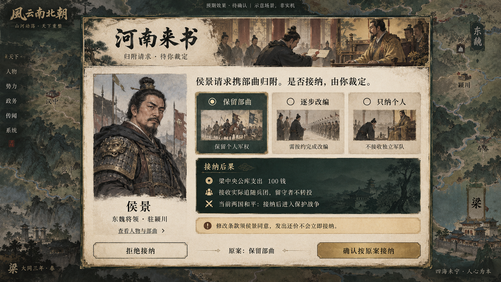
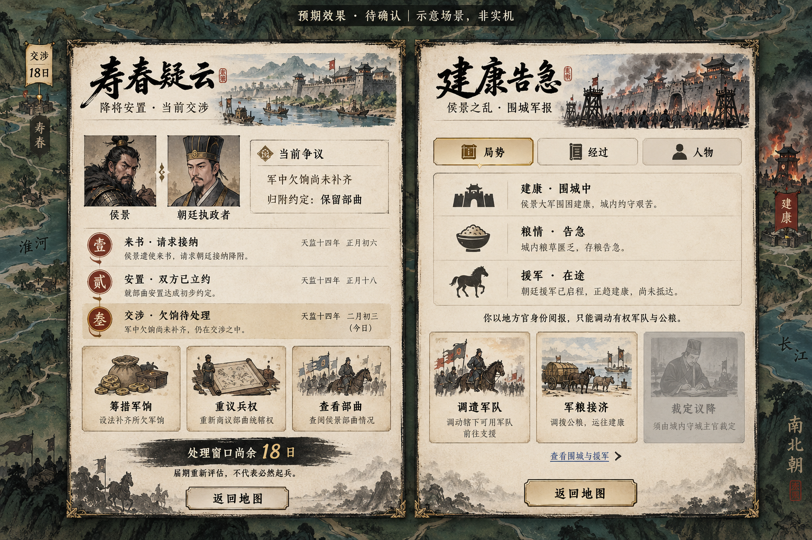
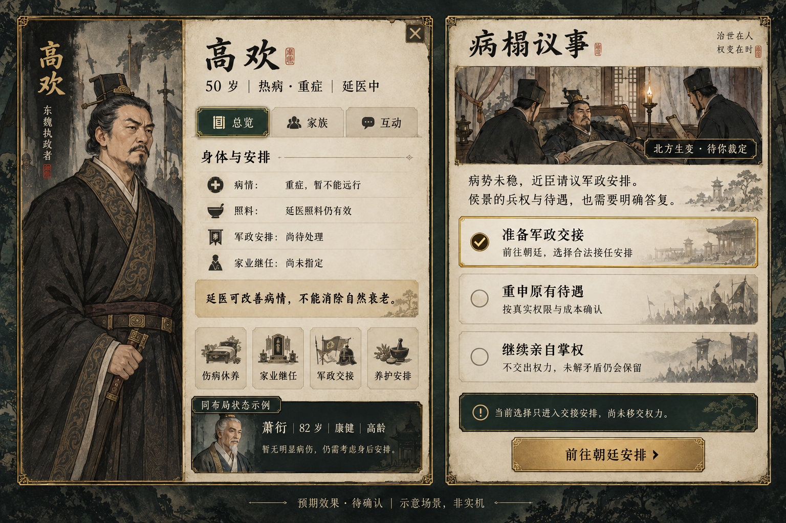

# 侯景之乱与健康提醒美术目标

类型：预期效果图与交互目标。状态：**待用户确认，非实机，未实施**。
范围：纳降裁决、事件卷宗／围城、人物健康／病榻议事。日期：2026-10-14。
规则和实施边界以 [落地方案](../../规划/侯景之乱与人物生命周期落地方案.md) 为准。

## 01 河南来书

重点确认纸面与墨绿后果框、三方案单选、人物与真实驻地、固定裁决区。当前画面展示“按原请求保留部曲”；改选后按钮必须变成“发出还价”，由对方确认后才执行。图中 100 钱来自现有接纳预算，实际预览仍须重算；兵数不能从图中猜测。

## 02 危机卷宗和围城

左为当前争议与已经发生的经过，右为地方官查看公开围城军报。18 日、时间线日期、军情及人物状态是排版示例，不作为剧情条件或固定开局数据。筹饷、重议、调军、接济打开实际行动弹窗，不能直接结算。军粮接济仅同地真实移交或走现有运输，不能远程瞬移。

顶部旗帜实际接入既有固定宽度事项区，不采用图中靠左的独立悬浮位置。战争阶段复用既有战争旗帜，防止同一围城挂两面旗。

## 03 身体与安排

左为人物健康区域的局部重排目标，并非删去现有人物身份、能力、特质和其他页签。年龄、健康、病情、照料分别表达；萧衍卡片是同布局的另一状态示例，正式高欢窗口不放无关人物的健康卡。

右为玩家扮演实际执政者时的待决。“准备军政交接”只导航到真实朝廷安排，完成合法命令前仍未交权。若不符合权限，不出现可以直接执行的交接按钮。

## 复用与排除

- 延续现有墨刷、纸色、旧金、线描淡彩风格；实际肖像沿用现有生成与遗传系统，图中人物仅示意，不能替换正式角色资产。
- 图外地图、左侧菜单、装饰文句、地名位置不是地图或导航重做提案；背景沿现有 Three.js 地图，地图地理与人物身份由真实状态提供。
- 生成图片不是可逐字迁入的规则资料。标题与控件中文须由正式文本渲染；新图饰不成为额外玩法数据。
- 战后复用卷宗“经过”布局，加真实结果与善后入口；康复复用纯通知模板。待决不放“知道了”，纯通知不塞虚假选择。
- 重点检查：人物／地点入口、单选与焦点、禁用原因、暗底对比度、滚动内容及常驻确认、跨身份内容和草稿作废。

## 生成记录

使用内置 image_gen，未使用 CLI。原始三组提示词和定向修订存于 [prompts.json](prompts.json)。保留选定图在本目录，未修改游戏运行资产。

本次只检查目标图与方案的一致性；最终视觉效果和实施后的前端均由用户人工验收。
