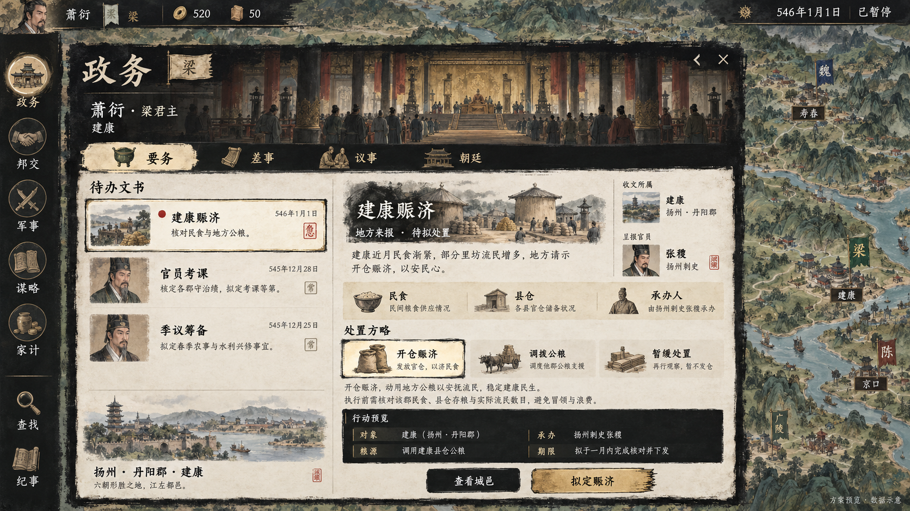
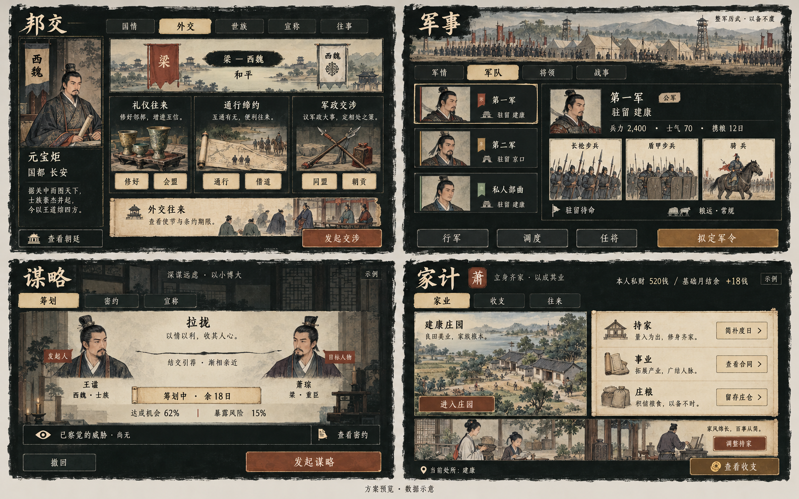

# 左侧操作栏沉浸感目标

类型：交互与美术目标。范围：政务、邦交、军事、谋略、家计，以及查找／纪事的统一方向。
状态：2026-10-13 新提案，待用户确认；未接入游戏。采用内置 imagegen 生成，不是实机截图。

## 政务主画面



## 其余四类页面



四宫格是四个独立页面的方向板，不拼成一个游戏页面。只确认墨刷、淡彩、纸面、身份与操作层级。人物肖像、地图、国号、任职、文书、日期和数值均为生成示意，可能与史实及当前游戏不符；正式制作须使用真实对象及现有已确认肖像，不照抄图中文字或生成新的游戏数据。图中将领数量、兵力、成功率和收益不是当前存档的状态。

## 从效果图到实际实现

- 沿用城市／人物页的墨色窗口与图像识别；场景图服务于对象识别，不把所有页面做成大插画。
- 政务待办区实际为空时显示当前职责、真实地方需求与简洁空态，不为匹配图中密度制造文书。图中“拟定赈济”只进入已有行动草稿；拟定与最终确认不能重复一遍相同选择。
- “朝廷”是同一外壳里的场景切换入口；进入后替换当前导航，不在四项下面叠放七项朝廷子导航。
- 邦交直接点击具体交涉选项进入其预览。图中“发起交涉”仅表示选定行动的主入口，不能另造与上方动作重复的通用按钮。
- 军事预览中“拟定军令”在确定行军／调度类型后显示相应动作名称。无军队时显示合法的征募／私募／求职入口与条件，不能用示例军队填充。
- 谋略的机会与暴露风险必须取现行规则；不知道的人与关系不显示。家计的私财、预测和公私划转分别标注。
- 图中纸上边框可进一步减弱，正文尺寸与按钮命中区由响应式前端完成。地图仍保留现有真实地形，不改成生成图里的示意地图。

完整的代码证据、各入口功能去向、交互和分期建议见[前端交互审查](../规划/前端交互审查.md#2026-10-13-左侧操作栏沉浸感评估提案未实施)。

## 生成方式与原始提示词

工具：内置 `image_gen.imagegen`；两张新生成图，不使用 CLI 或在线抓取素材。

### 政务

```text
Use case: ui-mockup. Generate a high fidelity 1920x1080 landscape game UI concept screenshot for a Chinese Northern and Southern Dynasties historical strategy RPG 风云南北朝. This is a proposed interface, not a screenshot of the running game. Render sharp legible simplified Chinese. Main reference direction: historically themed hand-painted Chinese ink wash portrait and city panels, very dark charcoal black brush-edged panels, restrained antique gold rules, warm ivory paper, muted moss green, tiny cinnabar seals. It must feel like a sophisticated historical strategy game, NOT a SaaS dashboard, not a generic fantasy game, not a 3D physical desk, no beveled gold frames.
Composition: underlying richly detailed green Three.js-style Chinese campaign terrain map remains visible on the right 28% and around panel. Top thin game HUD contains small painted emperor portrait with name 萧衍 at upper left, coins 520, influence 50, upper right 546年1月1日 and 已暂停. Left rail 64px wide at x0, five hand painted round restrained emblems with small labels 政务 邦交 军事 谋略 家计, below a gap utility icons 查找 纪事. Main brushed charcoal ink window from x90 to x1360, y145 to y970, with irregular ink edges. Title 政务 at upper left with small 梁 beside a single realm flag. Small plain return and X controls at upper right of panel. The top 150px inside panel is a dim painted Southern dynasties palace hall panorama, contextual not dominant, containing readable identity: 萧衍 · 梁君主 / 建康. No giant portrait, no stat tiles. Below this thin horizontal ONE row of tabs with original bronze pictograms: 要务 差事 议事 朝廷. 要务 is selected using pale parchment brush swatch, other tabs unboxed gold.
Content split: left 42% compact list of three relevant official memoranda, on warm mottled ivory paper under caption 待办文书. Each row has a small realistic painted portrait or city vignette, restrained seal, two lines text. Selected row thin dark ink edge and tiny cinnabar dot, text 建康赈济, subtitle 核对民食与地方公粮. Other rows 官员考课, 季议筹备. No colorful pills, no rounded repeated cards. Lower left compact local place link 扬州 · 丹阳郡 · 建康 with small painted city.
Right 58% selected memorandum: header a delicate small granary landscape sketch fading into dark ink, large readable title 建康赈济. Recipient city and official portrait links visible. Upper concise line 地方来报 · 待拟处置. Then a pale paper strip of three facts 民食 / 县仓 / 承办人 without invented quantities. Below label 处置方略 and three simple unboxed pictorial options: 开仓赈济, 调拨公粮, 暂缓处置; first selected clearly. A short 2-line readable summary identifies 地方公粮 and 执行前核对. Show a framed but simple dark paper area with 行动预览 explaining 对象、粮源、承办与期限. Footer always fixed, a subdued 查看城邑 button and a single ochre-gold primary 拟定赈济 button. This button opens the existing action preview rather than immediately executes. Bottom outside window tiny watermark 方案预览 · 数据示意.
Ensure generous 16-18px-equivalent body text, coherent hierarchy, subtle paper grain only, black ink boundaries, portraits as action entries, no web widgets, no large empty decorative illustration, no crowded labels. Only small realistic hand-painted icon illustrations. No charts, no KPI cards, no neon, no glassmorphism, no contemporary office controls. Polished and implementable UI art.
```

### 四类页面

```text
Use case: ui-mockup. Create one beautiful 2560x1600 landscape art direction board with FOUR high-fidelity Chinese historical strategy RPG interface concept panels in a precise 2x2 layout. Overall flat presentation on muted pale warm grey background, thin gutter, panel boundaries straight. Each quadrant is a legible complete concept excerpt of an implementable UI for 风云南北朝, not a website. Small board caption 方案预览 · 数据示意. Top-left 邦交, top-right 军事, bottom-left 谋略, bottom-right 家计. All four panels share the same black irregular Chinese brush-edged surface, old gold thin rules, warm ivory text, flat Chinese hand-painted line-and-wash illustrations, 16px-equivalent body text, parchment selected tab. Palette charcoal #121815, ink-green #213128, paper #ded2b4, old-gold #b39a62, cinnabar #984f41. Avoid ornate fantasy gold scrollwork, no thick gilded frames, no modern SaaS rounded cards, no charts, no glowing UI. No Roman/Tang/Qing costumes; Chinese sixth century painted figures and timber tiled architecture. Art supports useful objects and decisions. Compact headers, modest paintings, fully readable typography. Each quadrant fills its whole area with useful content, very little blank padding.
TOP LEFT 邦交: flat charcoal dossier with small flag 西魏 and small painted seated ruler portrait at left, concise identity 元宝炬 and 国都 长安. Tabs 国情 外交 世族 宣称 往事 on one line, 外交 selected. Main area shows counterpart identity and a simple bilateral relationship ribbon 梁 — 西魏 / 和平, then three groups of restrained illustrated action tiles with short labels 礼仪往来 / 通行缔约 / 军政交涉. Realistic miniature bronze cups, road scroll, crossed ceremonial weapons. Each group has 2 compact options like 修好, 会盟, 通行, 借道, 同盟, 朝贡. Lower area one parchment diplomatic document strip 外交往来, caption 查看使节与条约期限. Footer 查看朝廷 and chosen action 发起交涉. No large central world map, no fake metrics, no giant portrait.
TOP RIGHT 军事: top slim painted distant military encampment banner, title 军事. Tabs 军情 军队 将领 战事 with 军队 selected. Left 35% narrow roster, three banners and small painted commanders, named 第一军, 第二军, 私人部曲, locations 建康, 京口, 建康. One active army outlined subtly. Right 65% selected army: commander half bust very small beside 第一军 / 驻留建康 / 公军. Compact readiness line 兵力 2,400 · 士气 70 · 携粮 12日. A row of THREE illustrated unit cards of spear infantry, shield infantry, cavalry. Show marching status 驻留待命 and modest logistics line 粮运 · 常规. Footer context actions 行军 调度 任将, primary ochre 拟定军令. This is a selection overview, not a scrolling list of all army logistics.
BOTTOM LEFT 谋略: title over very subtle dark painted indoor screen backdrop. Tabs 筹划 密约 宣称, 筹划 selected. Main area two painted character dossier portraits linked by one restrained ink thread, first caption 发起人, second 目标人物; title 拉拢. Below a slender parchment progress strip 筹划中 · 余18日 and legible factual facts 达成机会 62% / 暴露风险 15%. Mark small 示例 in this quadrant to indicate invented preview data. Below a small row 已察觉的威胁 · 尚无 and icon text 查看密约. Footer secondary 撤回, primary 发起谋略. No sprawling decorative conspiracy network, no fake secret revelation.
BOTTOM RIGHT 家计: title 家计 and small family mark 萧. Tabs 家业 收支 往来, 家业 selected. Header horizontal unobtrusive private purse summary 本人私财 520钱 / 基础月结余 +18钱, small 示例. Main left 55% painted sixth-century manor and fields as a clickable vignette, title 建康庄园, action 进入庄园. Right 45% an ivory household ledger inset, dark ink readable headings 持家, 事业, 庄粮; text 简朴度日, 查看合同, 留存庄仓, lines like actual ledger but not tiny dense spreadsheet. Lower painted small household vignette with label 调整持家. Footer single gold 查看收支 plus subdued current place link. No mixing central treasury with private assets.
Four coherent distinct interfaces, matching a Chinese ink-brush character details window and illustrated city building cards. Focus each on identities, selected objects and meaningful actions. Do not include English UI text, browser chrome, repeated fake numbers, app dashboard grids, neon colors, exaggerated paper curl or giant decorative pictures.
```

