# 十一位历史人物画像预览

类型：美术目标与生成素材记录。范围：朱异、崔季舒、斛律光、于谨、彭乐、萧纶、王僧辩、羊鵾、王琳、萧纪、萧詧。
状态：2026-10-20 制作的独立预览，待用户确认；未替换游戏生产肖像。
核对依据：本轮十一张用户参考图、用户对第十一张“萧詧”的明确答复、现有 `src/data/expandedPeople.ts` 生年、前批已确认画风及下列传记。生成使用内置 image_gen。

## 画像与参考对应

统一为 1024×1536、2:3 半身立绘，暖白纸底、细线描和淡彩。约龄按游戏 546 年开局和已有生年计算，含剧本推定值，不作为新的生年考据。半侧面收为双眼可见的角度，持物靠近身体，便于后续登记五官及方形头像；没有复用旧底图的定位参数。

| 用户图 | 人物／游戏开局约龄 | 保留与调整 | 原图 |
| --- | --- | --- | --- |
| 1 | 朱异／63 岁 | 蓝袍、青绿金缘、高冠、金珠与羽扇，增加年长面部和须发层次；不放钱箱 | [朱异](zhu-yi.png) |
| 2 | 崔季舒／46 岁 | 灰紫纹袍、小冠、托盘与青瓷器，保留警觉侧目；器物按早期青瓷执壶方向演绎 | [崔季舒](cui-jishu.png) |
| 3 | 斛律光／31 岁 | 银灰甲、紫巾、彩羽盔、弓与箭囊，收敛扬臂和过大羽饰 | [斛律光](hulu-guang.png) |
| 4 | 于谨／53 岁 | 灰毛缘盔、红褐札甲、黑灰披风及长柄兵器，背身改半侧正面 | [于谨](yu-jin.png) |
| 5 | 彭乐／47 岁 | 铜盔、重札甲、赤巾、毛缘袖与勇烈神态；不把战斗流血、腹部伤势固化为健康立绘 | [彭乐](peng-le.png) |
| 6 | 萧纶／39 岁 | 赭橙纹袖、灰银胸甲、束发冠与长柄环首剑，保留宗室武装方向 | [萧纶](xiao-lun.png) |
| 7 | 王僧辩／41 岁 | 双羽盔、红褐胸甲、红披风与旗杆，旗幅缩为无字小幅 | [王僧辩](wang-sengbian.png) |
| 8 | 羊鵾／21 岁 | 素白衣、灰袖、布带、朴素束发与槊杆，改为自然头颈和青年体态 | [羊鵾](yang-kun.png) |
| 9 | 王琳／20 岁 | 赭红肩袍、双片胸甲、护腕和环首佩剑，以青年五官呈现 | [王琳](wang-lin.png) |
| 10 | 萧纪／38 岁 | 浅色立冠、灰披风、红纹袍和银饰腰带，不前置称帝 | [萧纪](xiao-ji.png) |
| 11 | 萧詧／27 岁 | 赭金纹袍、白内衬、束发及骷髅形酒杯；按用户确认制作萧詧，双眼不加眼罩 | [萧詧](xiao-cha.png) |

| 朱异 | 崔季舒 | 斛律光 |
| --- | --- | --- |
| 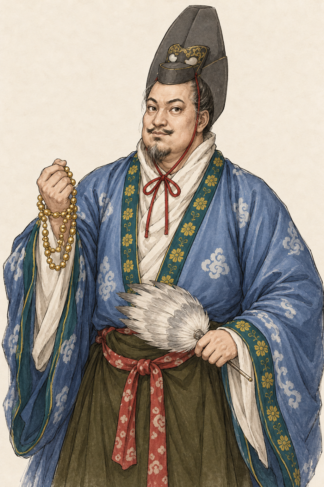 | 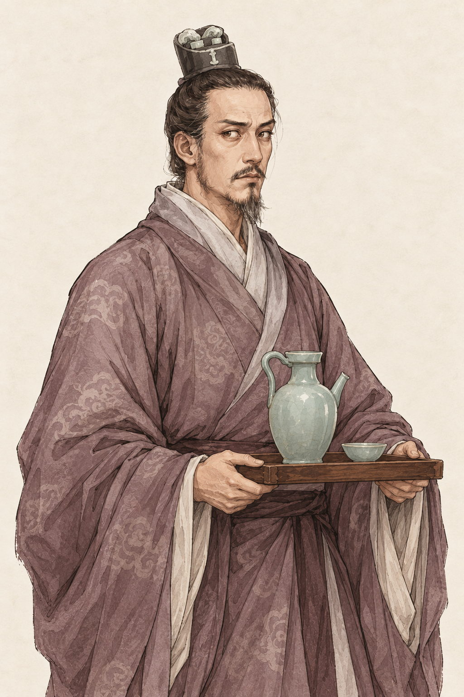 | 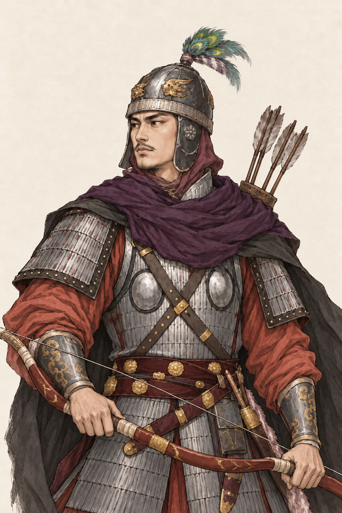 |

| 于谨 | 彭乐 | 萧纶 |
| --- | --- | --- |
| 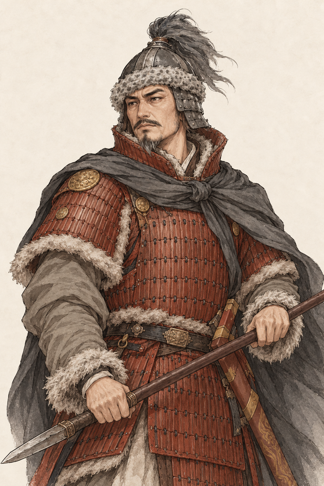 | 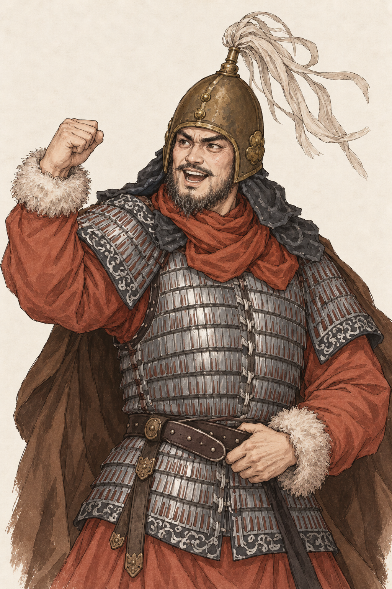 | 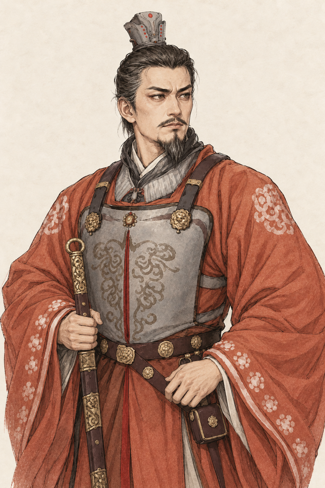 |

| 王僧辩 | 羊鵾 | 王琳 |
| --- | --- | --- |
| 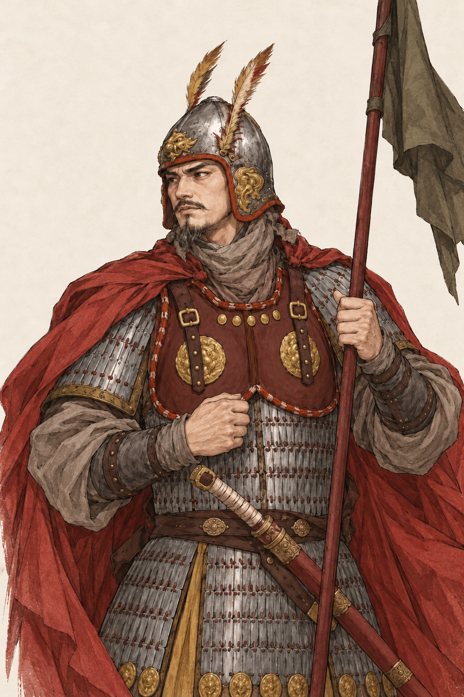 | 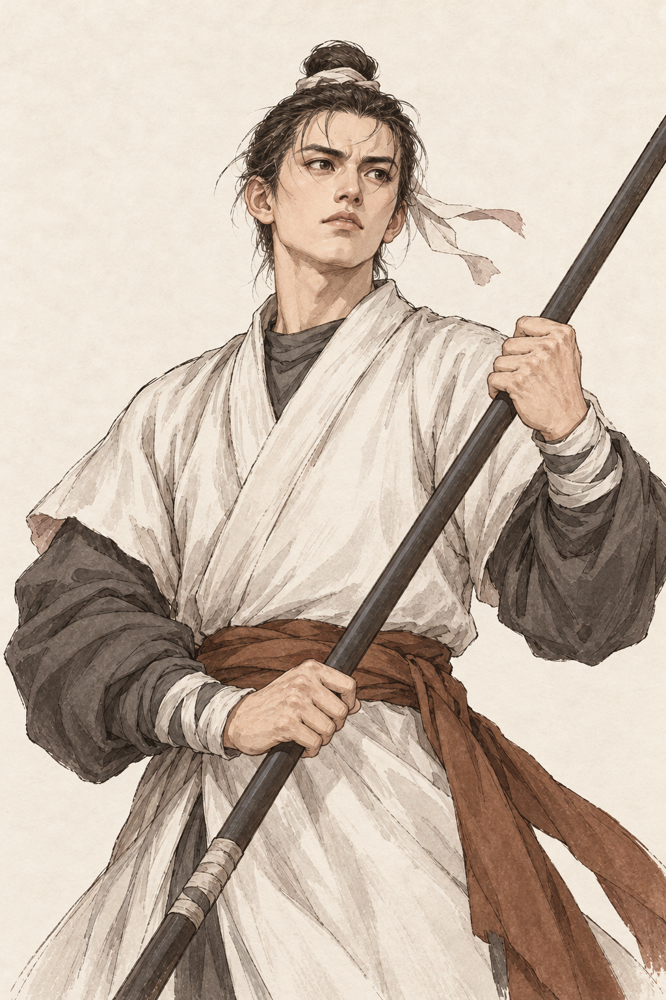 | 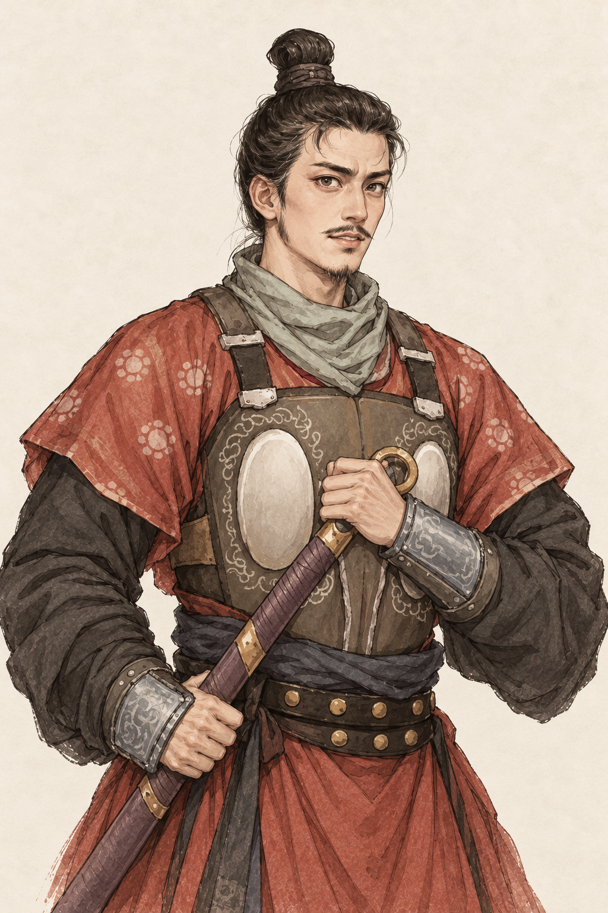 |

| 萧纪 | 萧詧 |
| --- | --- |
| 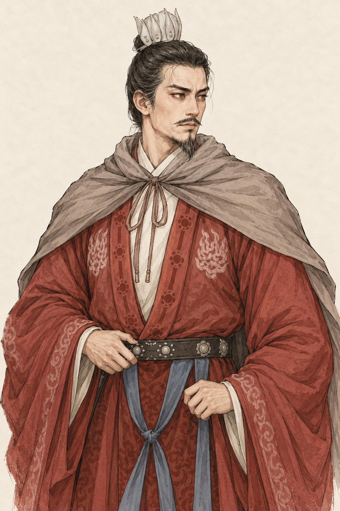 | 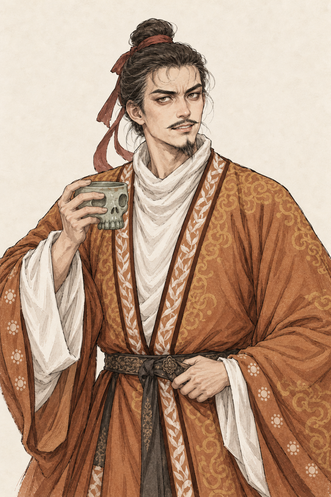 |

## 史料与演绎边界

本轮核对人物身份及时代边界，具体五官、表情、冠甲、颜色、纹样和持物来自现代参考图与美术推演，不能视为确证容貌或精确礼服复原。没有根据画像改变历史人物、出生年、文化、性格、亲缘、官职、伤势或持久化数据。官冠与甲胄仅为本批画面方向，正式接入仍须按实际身份换装。

| 人物 | 本轮核对传记 | 使用边界 |
| --- | --- | --- |
| 朱异 | [《梁书》卷三十八](https://zh.wikisource.org/wiki/梁書/卷38) | 参考其梁朝文臣背景；金珠、羽扇和神态是现代参考演绎 |
| 崔季舒 | [《北齐书》卷三十九](https://zh.wikisource.org/wiki/北齊書/卷39) | 核对博陵出身与东魏朝廷经历；托盘与青瓷不代表固定身份、嗜好或职位 |
| 斛律光 | [《北齐书》卷十七](https://zh.wikisource.org/wiki/北齊書/卷17) | 保留骑射方向，不提前使用后来爵号或北齐身份；羽饰形制属演绎 |
| 于谨 | [《周书》卷十五](https://zh.wikisource.org/wiki/周書/卷15) | 西魏将领方向，表现成熟沉稳；不据参考图背影推造伤病 |
| 彭乐 | [《北史》卷五十三](https://zh.wikisource.org/wiki/北史/卷053) | 勇烈与军旅方向；史载受伤经历不变为默认当前出血状态 |
| 萧纶 | [《梁书》卷二十九](https://zh.wikisource.org/wiki/梁書/卷29) | 梁宗室方向，不将后来的征讨身份和事件结果提前 |
| 王僧辩 | [《梁书》卷四十五](https://zh.wikisource.org/wiki/梁書/卷45) | 梁军旅方向，不用后来官爵改变开局实际权限 |
| 羊鵾 | [《梁书》卷三十九·羊侃附子传](https://zh.wikisource.org/wiki/梁書/卷39) | 本传写作“鶤”，按游戏现名“羊鵾”归档；不与羊鸦仁混同，不前置后来的刺杀场景 |
| 王琳 | [《北齐书》卷三十二](https://zh.wikisource.org/wiki/北齊書/卷32) | 核对其梁朝起点和少习武事，游戏开局仍按青年；未以传记书名更改效忠 |
| 萧纪 | [《梁书》卷五十五](https://zh.wikisource.org/wiki/梁書/卷55) | 梁宗室方向，不预设后来的蜀中称帝、冲突和结局 |
| 萧詧 | [《周书》卷四十八](https://zh.wikisource.org/wiki/周書/卷48) | 用户明确指定为萧詧；保留骷髅形陶杯这一参考道具，不声称它是已核实的生活习惯，不前置后梁君位 |

引用卷次按本轮实际查阅的传记登记；没有顺带改写剧本原有出处字段或年龄估值。十一张现代来图原样保存在 `references/`，原图已有水印随副本保留；用户未提供原始发布链接，不推断作者身份。系列画风仅参考[已确认的高欢预期图](../historical-five-546-v1/gao-huan.png)的纸面、线条和设色，不复制其脸部与服装。

## 生成、检查与后续接入

[完整实际提示词与文件映射](prompts.json)逐人保存。本批使用内置 image_gen，选定输出按生成原件逐字节复制，未离线绘改、裁切或合成。斛律光、王僧辩首版羽饰贴近上沿，分别通过 image_gen 缩短羽饰并补足上缘留白，两条修正提示词和首版来源随映射保留。

本轮是待人工美术确认的画像预览。正式接入还需逐人登记五官、方形头像及身份换装，接入共用消息／事件肖像和缓存规则；不以生成提示词或画布尺寸代替实际锚点核对。素材目视检查不等于用户认可，也不代替游戏 UI 人工验收。

文件检查通过：十一张 PNG 均为 1024×1536，全部块校验、选定生成原件及十一张参考副本的逐字节一致性、十一条初始提示词与两条羽饰修正映射、116 个本地文档链接通过。本地十一张画像返回 HTTP 200，类型为 PNG 且响应字节与文件一致；游戏入口、内容包及模拟 Worker 可读。未改生产代码或资源，未为本批预览运行构建、长局或完整游戏回归。
