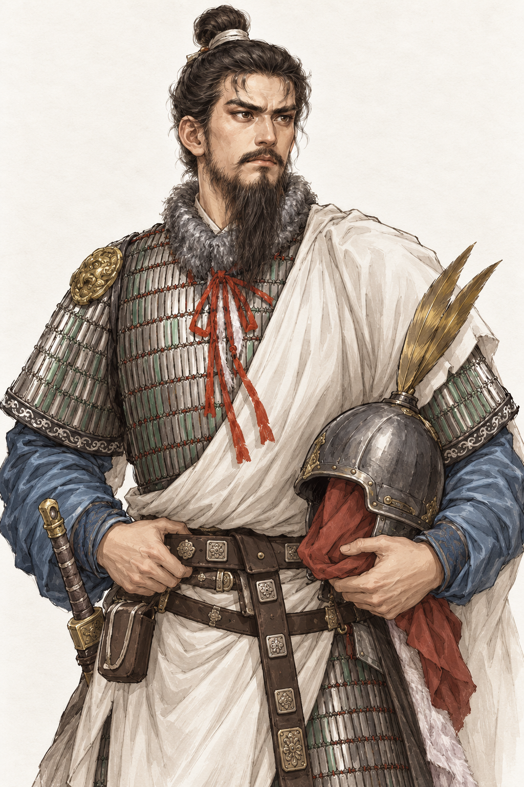
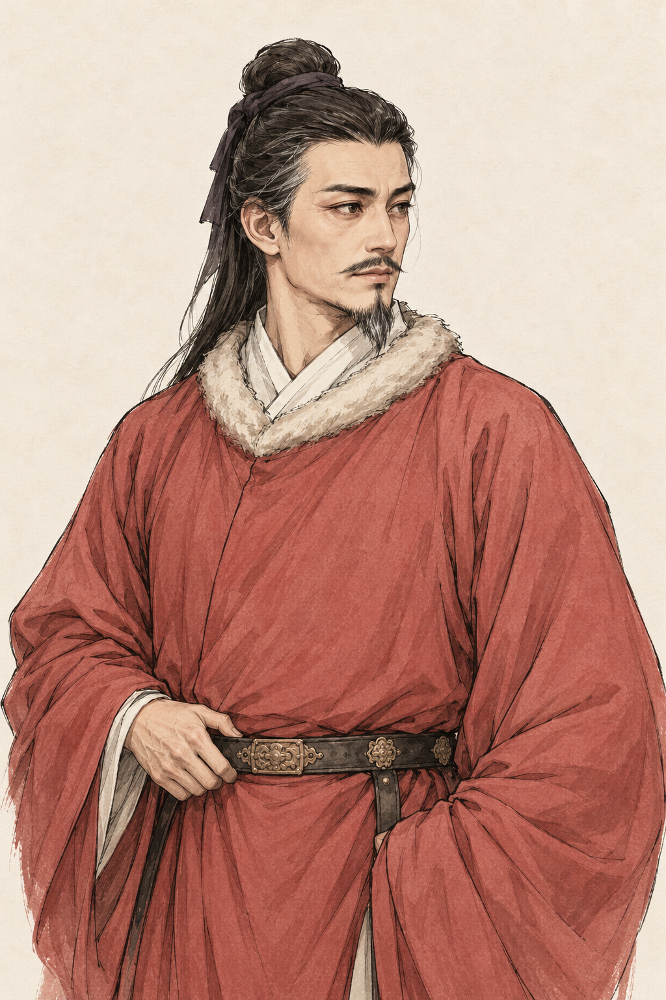
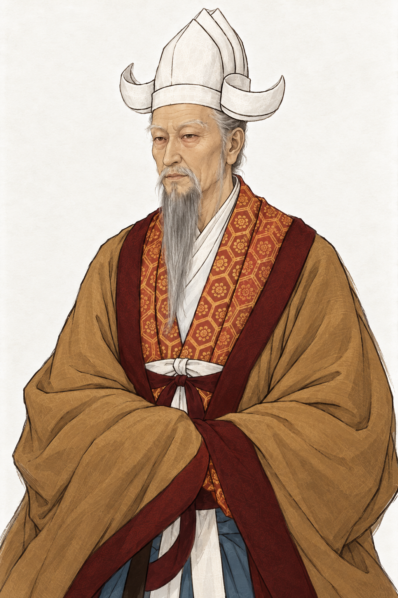
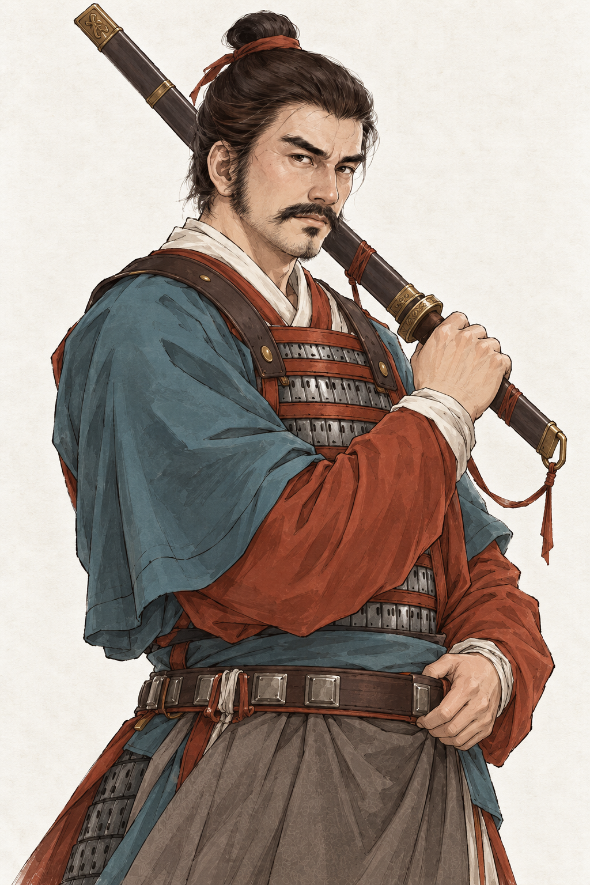
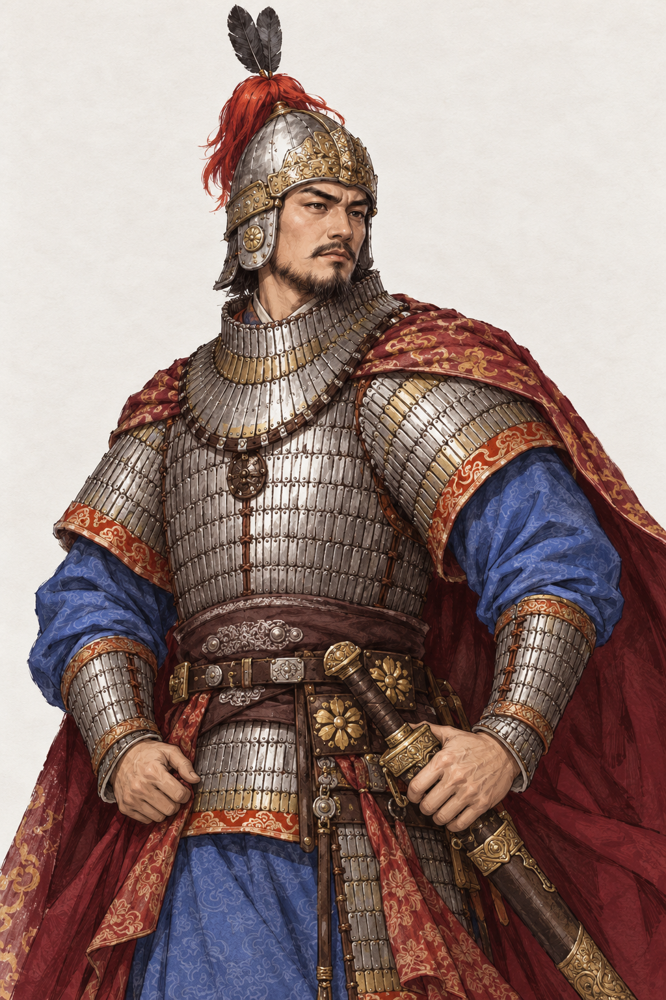

# 五位历史人物肖像预期图

类型：美术目标与生成素材记录。范围：宇文泰、高欢、萧衍、侯景、陈霸先。
状态：2026-10-17 用户已确认五张预期图并授权接入；已本地接入共用肖像入口，新增换装及游戏内显示待人工验收。未修改人物、年龄、身份、遗传参数或存档。
核对依据：用户本轮五张参考图，游戏 `src/data/scripts.ts`、`lifespans.ts`、`expandedPeople.ts`、`portraitProfiles.ts`，现有 C 风格立绘与项目人物形象规则。生成方式为内置 image_gen；未使用 CLI/API 回退。

## 预期图

五张均为 1024 × 1536 PNG，2:3 半身构图，细线描与淡设色、浅纸底。它们是参考图和史料描述基础上的艺术演绎，不是确证的历史容貌或服饰复原。面貌、衣冠与手部姿态由用户人工确认；没有进行浏览器自动化、UI 验收或截图比对。

| 人物 | 按游戏 546 年开局呈现 | 采用与调整 | 预期图 |
| --- | --- | --- | --- |
| 宇文泰 | 约 39 岁，西魏执政；游戏生年为估计 | 保留图 1 的阔额、甲胄、蓝袖、白披帛和抱盔；补长须与成熟感，不作帝王冠服 | [原图](yuwen-tai.png) |
| 高欢 | 约 50 岁，东魏执政、渤海王 | 保留图 2 的长脸、高颧、发髻、赭红袍与浅毛领；增加眼周纹理、鬓须微白与年龄感 | [原图](gao-huan.png) |
| 萧衍 | 约 82 岁，梁皇帝 | 依图 3 保留白色高冠、细长眉眼、灰白长须、赭袍深红缘与拱袖；此次白冠方向优先于旧配置的黑色高冠 | [原图](xiao-yan.png) |
| 侯景 | 约 43 岁，仍属东魏的将领；游戏生年为估计 | 保留图 4 的蓝衣红袖、甲片、发髻与肩后横刀；去掉刀疤、血迹和夸张浓鬓，面貌收敛为警觉的成年将领 | [原图](hou-jing.png) |
| 陈霸先 | 约 43 岁，梁朝将领，尚未建陈 | 保留图 5 的蓝袍、铁甲、朱红披风、头盔红缨与双羽；缩小羽饰，改为静态半身，不加入帝王冠服 | [原图](chen-baxian.png) |

## 来源与演绎边界

- 宇文泰：[《周书》卷一原文](https://www.shidianguji.com/zh/mid-page/7340117727119671306)记有阔额与须髯特征。本图据此补须；不将帝王传记中的神异记述转成生理设定。
- 高欢：[《北齐书》卷一](https://zh.wikisource.org/wiki/北齊書/卷1)记有长头、高颧及眼神特征。本图用以约束轮廓与眼形；皱纹和灰发是按游戏年龄做的美术解释。
- 萧衍：主要外观依据为用户图 3；现有游戏另记录[故宫《历代帝王半身像·梁武帝》](https://digitalarchive.npm.gov.tw/Collection/Detail/15644?dep=P)。馆藏传世画像不等于同时代写生，也不能据此证明本图的白冠形制与配色。本轮没有下载、嵌入或复制馆藏原图。
- 侯景：[《梁书》卷五十六](https://zh.wikisource.org/wiki/梁書/卷56)、[《南史》卷八十](https://zh.wikisource.org/wiki/南史/卷80)为人物经历的史料参照；外形描述另参考[《南史》卷八十镜像](https://xuoda.com/ls/nanshi/424.htm)的检索摘录，镜像全文未成功读取。体态、目光、肤色和须发仅作克制演绎，不以图 4 的伤疤和血迹作为历史身份特征，不推定有争议的族属。
- 陈霸先：[《陈书》卷一](https://zh.wikisource.org/wiki/陳書/卷1)用于核对人物与时序。盔甲、羽饰、披风和面容主要来自用户图 5 的原创转绘方向，不宣称为出土装备复原或确证容貌。
- 用户提供的五张现代参考图仅作为本轮创作输入，保存在 `references/`，原作者和原始来源未提供。预期图不保留原图题字、水印、背景印章和地图。
- 系列画风参照现有游戏资产 `public/art/portraits/painted-c/cultures/yuwen-tai-xianbei-v1.png`，只取线条、设色与材质表达，不把该人物的脸和衣冠复制给其他人。

完整实际提交提示词及每张参考图映射见 [prompts.json](prompts.json)。内置生成原件保留在 Codex 的 generated_images 目录；本目录保存其逐字节相同的项目副本。

## 首轮预览的检查边界

- 本轮只交付预期图，没有替换 `public/art/`、修改渲染配方或生成内容包。
- 五张是完整立绘，尚未拆分无五官底稿与五官来源，也未登记新画面的逐项面部锚点、小头像裁切、身份格及换装。后续接入必须按新画面登记，不能沿用旧坐标或重抽旧档遗传参数。
- 已检查五张 PNG 尺寸、文件完整性与项目副本一致性；查看了生成原图，未将此记为用户美术验收。
- 本地 Vite 监听 `127.0.0.1:5173`，游戏入口和五张预期图均返回 HTTP 200；三份相关文档的本地链接检查和 `git diff --check` 通过。只读 HTTP 检查不代表浏览器 UI 或玩法验收。本轮未改游戏代码，因此没有运行构建、单元测试、长局测试或完整游戏回归。

## 用户确认后的本地接入

用户回复“没有问题，按照效果图风格……接入游戏”，确认的是本页五张原始预期图。运行素材、分层与四种身份格详见[生产素材说明](../../../../public/art/portraits/painted-c/historical-five-v1/README.md)；代码接入与验证事实追加于[迭代整合进度](../../../实施记录/迭代整合进度.md)。游戏 UI、新生成换装和合成效果仍待人工验收。
