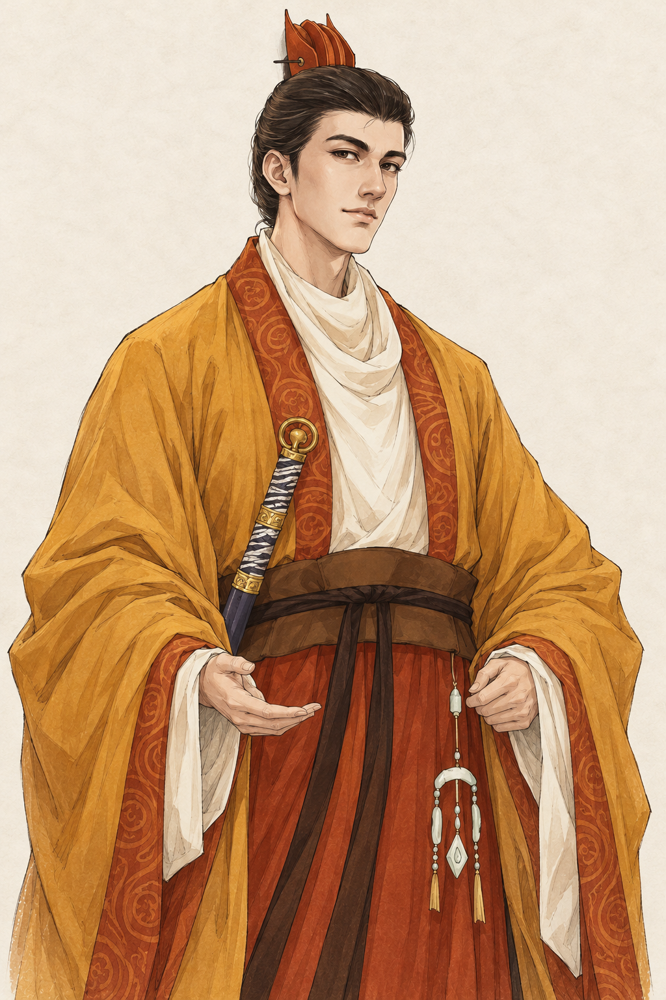
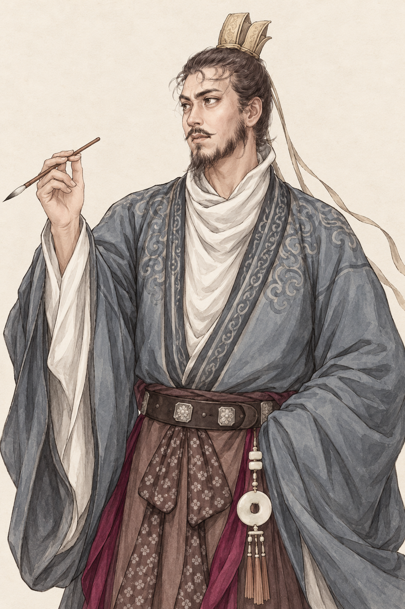
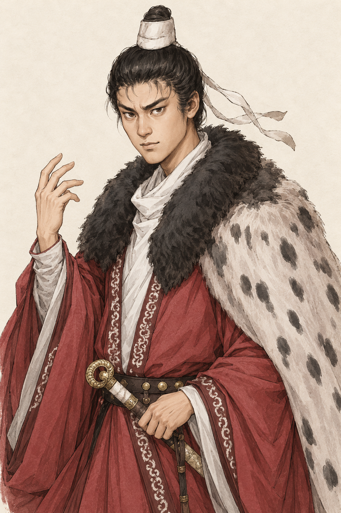
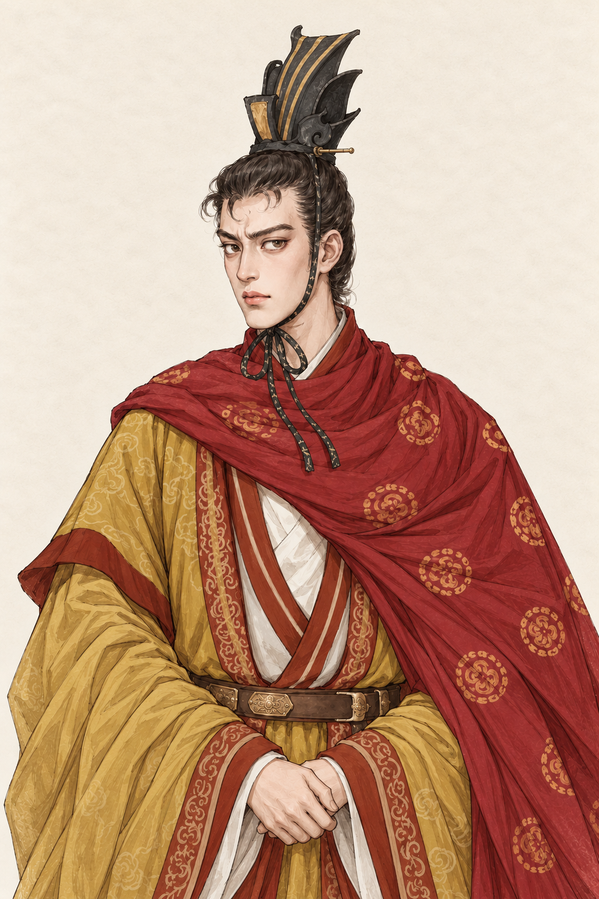

# 高澄、萧纲、高洋、元善见肖像预期图

类型：美术目标与生成素材记录。范围：用户本轮四张参考图对应的四位人物。
状态：2026-10-17 用户已确认四张预期图并要求接入；已本地接入共用肖像入口，新增换装及游戏内显示待人工验收。以下保留首轮预览与生成记录。
核对依据：用户参考图、上一批已确认的线描淡彩风格，游戏 `characters.ts`、`lifespans.ts`、`portraitProfiles.ts` 的人物、时序及外观规则。使用内置 image_gen；未使用 CLI/API 回退。

## 四张预期图

均为 1024×1536 PNG、2:3 半身构图与浅纸底。保留各参考图的辨识特征，统一线描、设色、面部细节及构图尺度；地图、题字与水印不进入新图。容貌、冠服、纹样和姿态属于艺术演绎，不声称为确证容貌或服饰复原。

| 人物 | 546 年开局呈现 | 参考特征与调整 | 原图 |
| --- | --- | --- | --- |
| 高澄 | 约 25 岁，渤海王世子、大将军 | 俊朗长脸、无须、赭金宽袖、红褐衣缘、佩剑与小冠；展开双臂改为腰前收拢的手势 | [高澄](gao-cheng.png) |
| 萧纲 | 约 43 岁，梁皇太子 | 灰蓝文士袍、白色内领、短须、额前卷发及执笔；增加成熟感，保留书卷气 | [萧纲](xiao-gang.png) |
| 高洋 | 约 17 岁，东魏太原公、尚书左仆射 | 强眉锐目、白小冠、红袍、黑毛领与浅色斑纹披裘；面貌年轻化、须发减淡，肤色加深、颊部略宽而下颌收尖 | [高洋](gao-yang.png) |
| 元善见 | 约 22 岁，东魏皇帝 | 青年长脸、卷曲额发、无须、黑色高冠、赭袍与红色织锦披风；减弱眼周浓红，神情克制，补全冠顶留白 | [元善见](yuan-shanjian.png) |

## 史料与创作边界

- 高澄：[《北齐书》卷三](https://zh.wikisource.org/wiki/北齊書/卷3)用于核对世子身份、入辅朝政、任大将军及青年时期的神情记述。新图采用参考图的俊朗面貌和赭金色衣装，没有将他在 546 年画为在位皇帝。
- 萧纲：[《梁书》卷四](https://zh.wikisource.org/wiki/梁書/卷04)记载其出生、立储和 549 年即位时序。本轮按皇太子制作；灰袍、执笔、眉眼与须发主要依用户参考图，并非从文字史料推得的确切容貌。无补零卷号的链接未成功读取，本页采用实际可读的 `卷04`。
- 高洋：[《北齐书》卷四](https://zh.wikisource.org/wiki/北齊書/卷4)的肤色与颊颌描述用于调整轮廓，也据此核对 546 年尚未称帝。本图不采纳传记中神异、生理异象等描写；少须和年轻面貌是按游戏生年所作的美术解释。
- 元善见：[《魏书》卷十二](https://zh.wikisource.org/wiki/魏書/卷12)用于核对即位、身份与时序。面容、红披风、织锦及冠形主要来自参考图；直立黑冠为通天冠方向的美术简化，不加冕板与旒珠，不宣称该具体冠形有同时代实物依据。
- 用户提供的四张现代参考图原样保存在 `references/`，未提供作者及原始来源；仅作为本轮创作输入。风格参照[上一批高欢预期图](../historical-five-546-v1/gao-huan.png)，不复制该人物的面容、年龄、须发和衣装。

## 生成、检查与接入边界

完整实际提示词、参考图映射、原始生成文件名及元善见冠顶修正提示见 [prompts.json](prompts.json)。四张最终图均是内置生成原件的逐字节副本，生成原件保留在 Codex generated_images 目录。元善见首版冠顶被上缘截断，使用 image_gen 单项修正构图后采用本页最终图；没有用离线缩放、裁图、重绘或合成代替生成编辑。

检查覆盖原图目视、PNG 尺寸与文件完整性、项目副本一致性、文档链接及本地 HTTP 可读性。原图目视不等于用户审美验收，未进行浏览器自动化或 UI 验收。

本轮未修改游戏肖像配方、生产素材、人物数据、遗传参数、职位或存档；没有触发代码构建、规则测试或游戏回归。后续接入须按四张新画面独立登记五官、小头像和实际身份换装，复用已有共用肖像、消息、年龄与健康机制，不沿用旧底稿坐标。

## 用户确认后的本地接入

同日用户明确要求“接入游戏”，四张确认图原样保存为各自原身份的生产底图，并补齐四种实际身份服饰与配套去五官底稿。详见[生产素材说明](../../../../public/art/portraits/painted-c/historical-four-v1/README.md)。按实际图像独立登记采样与头像裁切，保留旧档遗传差异及年龄／健康效果，不改变人物、职位或消息裁决机制。用户确认范围为首轮四张预期图，新增换装和游戏 UI 仍待人工验收；具体代码与兼容检查追加于[迭代整合进度](../../../实施记录/迭代整合进度.md)。
