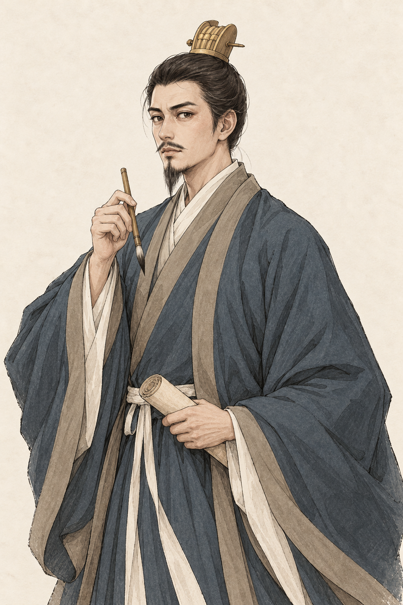
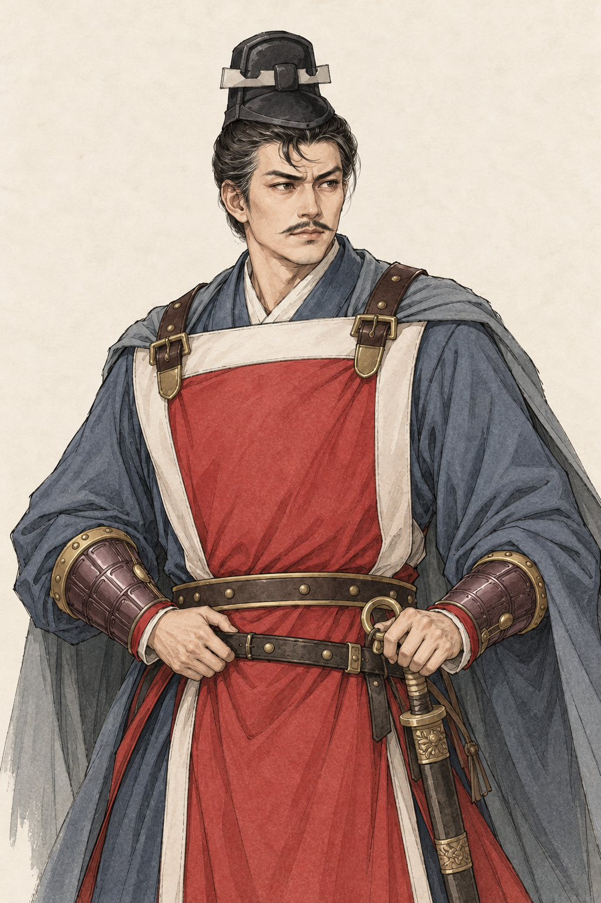
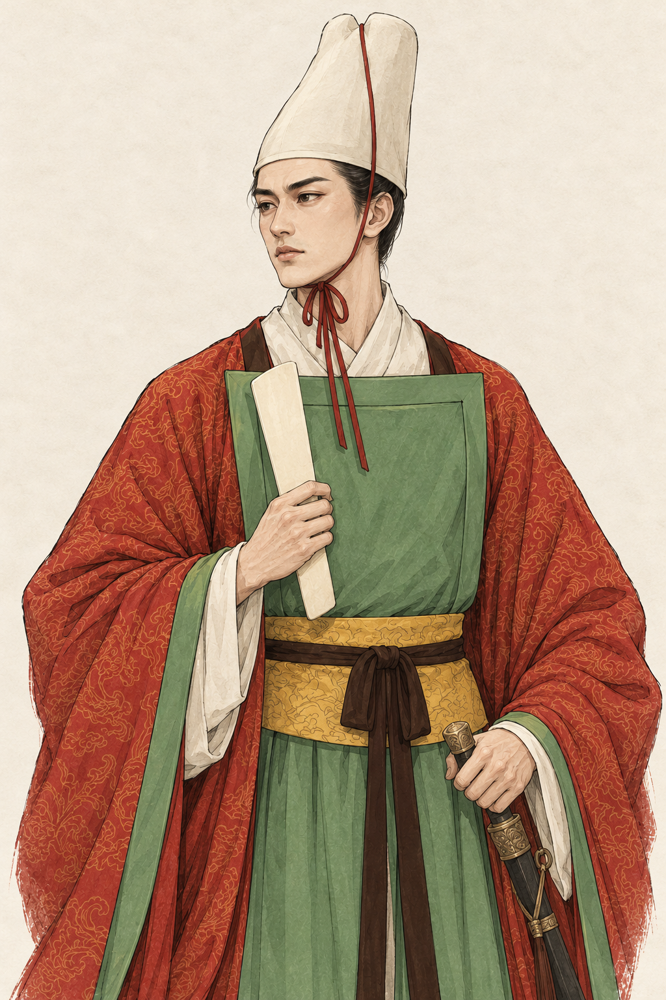
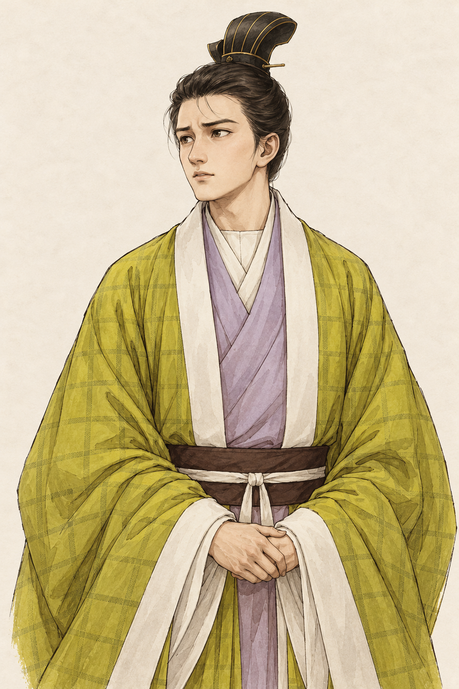
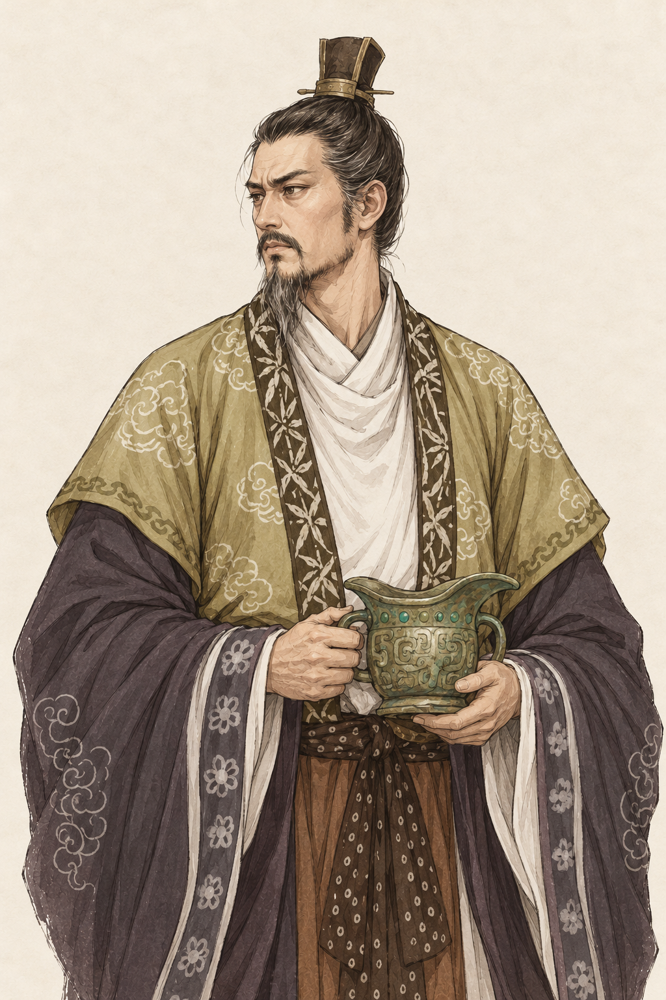
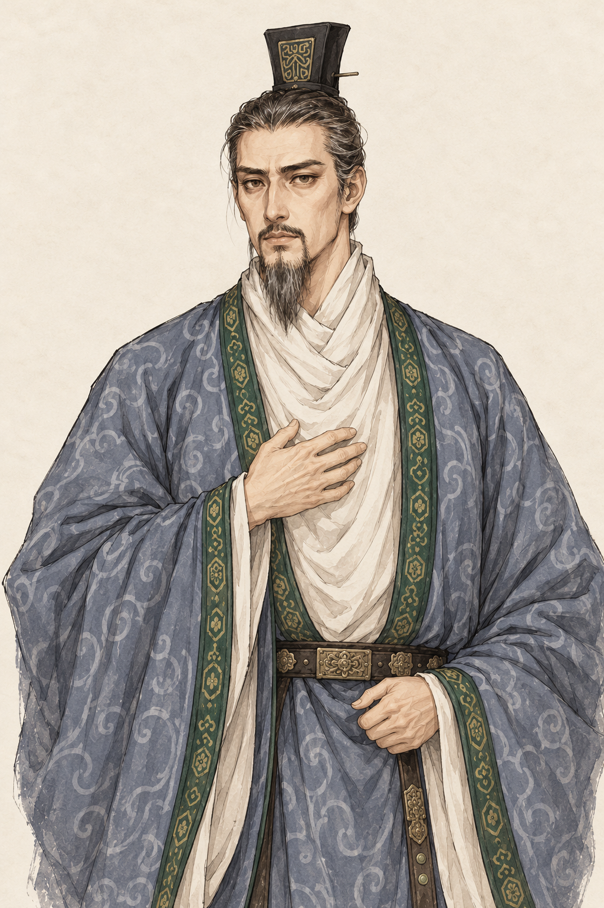
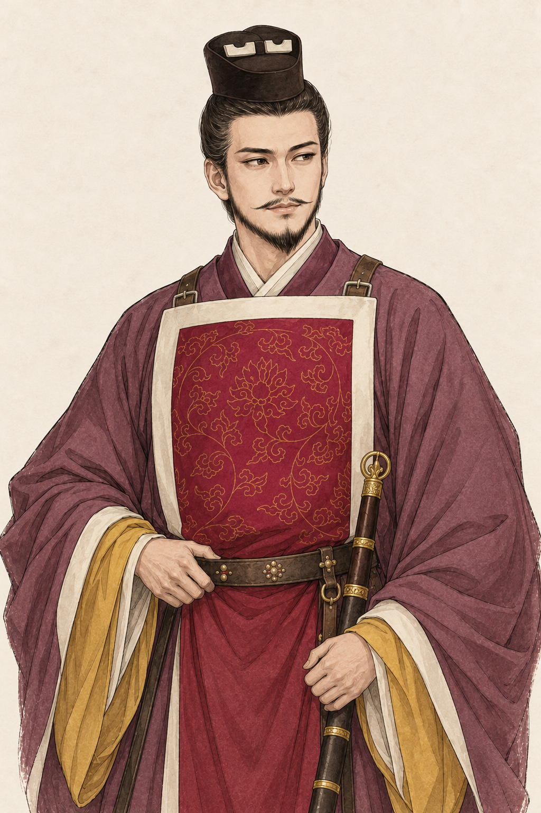
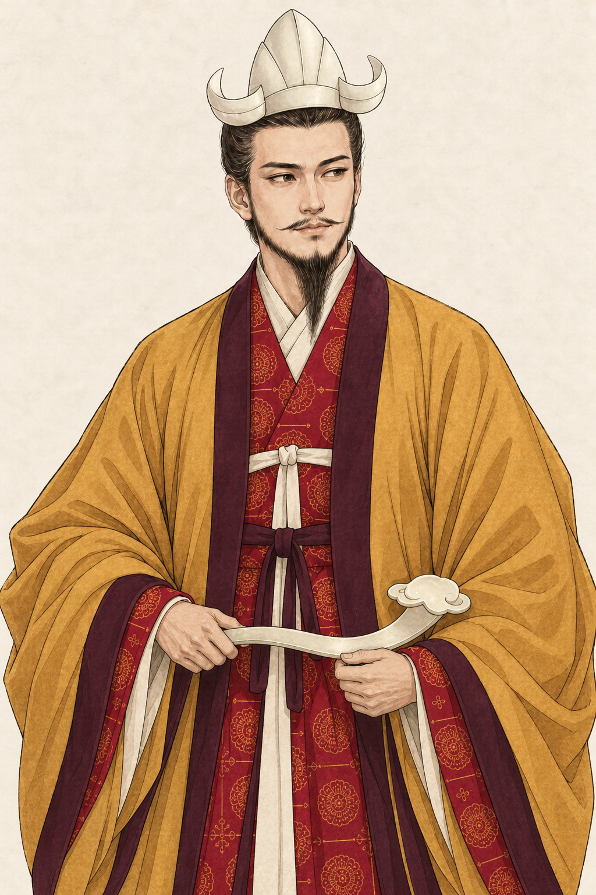

# 魏收等七位人物画像与陈蒨双身份

类型：美术目标、生成素材与接入记录。日期：2026-10-21。
范围：魏收、李虎、元钦、元廓、萧渊明、萧懿、陈蒨；七人八张原图。
状态：用户明确授权效果图完成后直接接入，无需再次确认；原图、换装和新增人物均已接入，实际界面仍待人工验收。

## 原图与设定

八图均为内置 image_gen 生成的 1024×1536、2:3 独立立绘，沿用已确认的细线描淡彩、暖白纸底。参考图的地图、文字、字幕、图标和水印不进入新画像。

| 来图 | 人物 | 546 年年龄／画像方向 | 原图 |
| --- | --- | --- | --- |
| 1 | 魏收 | 39 岁；蓝灰袍、简冠与书笔，保留文士气质 | [魏收](wei-shou.png) |
| 2 | 李虎 | 46 岁；青灰衣、红白胸甲、黑冠与佩剑 | [李虎](li-hu.png) |
| 3 | 元钦 | 21 岁；白冠、绿裲裆与红纹袖，侧面收为双眼可见 | [元钦](yuan-qin.png) |
| 4 | 元廓 | 16 岁；青黄格纹袍、浅紫内衬与少年面貌 | [元廓](yuan-kuo.png) |
| 5 | 萧渊明 | 56 岁；橄榄金袍、深袖与双耳青铜器 | [萧渊明](xiao-yuanming.png) |
| 6 | 萧懿 | 已故，享年 50 岁；蓝灰纹袍、青缘与抚胸姿态 | [萧懿](xiao-yi-elder.png) |
| 7 | 陈蒨·官员 | 24 岁；紫袍、红白胸前衣装、黑冠及佩剑 | [陈蒨官员](chen-qian.png) |
| 8 | 陈蒨·皇帝 | 同一面貌；赭金外袍、白色通天冠、酒红内服与如意 | [陈蒨皇帝](chen-qian-sovereign.png) |

| 魏收 | 李虎 | 元钦 |
| --- | --- | --- |
|  |  |  |

| 元廓 | 萧渊明 | 萧懿 |
| --- | --- | --- |
|  |  |  |

| 陈蒨·官员 | 陈蒨·皇帝 |
| --- | --- |
|  |  |

## 历史资料与游戏设定

萧懿为萧顺之长子、萧衍之兄、萧渊明之父，500 年去世；新增为已故家谱人物，不参与 546 年行动。萧渊明为在世梁宗室，封贞阳侯；不前置 547 年北伐、被俘或 555 年帝位。两人的亲缘和生平以本轮查阅的[《南史》卷五十一](https://zh.wikisource.org/wiki/南史/卷51)、[《北齐书》卷三十三](https://zh.wikisource.org/wiki/北齊書/卷33)为依据。稳定 ID 分别为 `xiao-yi-elder` 与 `xiao-yuanming`，不改用已有萧绎的 `xiao-yi`。

按用户要求，萧懿采用生年 450、卒年 500、享年 50，萧渊明采用生年 490、开局年龄 56。生年为游戏设定，不声称史料确证；年龄界面统一显示整数、不加“约”，来源和设定边界保留在资料记录。萧渊明开局驻建康也是剧本安排，不冒充已确证的当日行踪。其他五人沿用游戏现有生年及真实世界身份，李虎、元廓的原生年仍属既有剧本估值。

魏收文士经历参见[《北齐书》卷三十七](https://zh.wikisource.org/wiki/北齊書/卷37)。其余既有条目继续使用游戏登记的传记出处。五官、冠服、甲胄、纹样、青铜器及如意是现代参考图和游戏美术推演，不是确证容貌或礼制复原。陈蒨通天冠不加冕旒；两张原图表现同一身份实体的服饰变化，不创建第二个陈蒨或触发继位。

## 文件与接入

[完整实际提示词与源文件映射](prompts.json)保存八张原图的生成请求；`references/` 原样保留八份用户来图，已有水印仅随参考副本留存。八张生成原件逐字节复制入项目，未以离线绘改、裁剪或拼图替代生成。

正式接入复用八层五官合成、稳定遗传参数、实际身份选衣、年龄／健康／已故叠层、方形头像、消息透明立绘和缓存。每张原件与四格换装须分别登记面部坐标和头像裁切；陈蒨皇帝版使用独立原件及底稿。换装不授予官职、军队或君位。新开局和旧行记均应补入正确人物、亲缘与死亡状态，旧档已有资源和基因保持。

正式素材共 30 张 PNG，来源和完整配套提示词见[生产说明](../../../../public/art/portraits/painted-c/historical-seven-v1/README.md)。共用历史画像登记现覆盖 39 人；八张原件和 28 个身份格独立登记六项五官及方形头像。陈蒨实际成为君主时使用独立皇帝原件，其他角色随真实身份换装。新旧存档均复用同一人物与亲缘。

验证：12 个相关测试文件共 151 项局部用例通过（早期迁移用例修正后定向复查）；`npm run build` 与 854 项地图发布资源检查通过。27 个修改前已捕获官方锁逐一重建并从内容库恢复，旧世界、钱包、库存和实际基因差异保留；新增人物补录、再次保存、非法锁和校验拒绝、隔离 IndexedDB 的源文件／档位不变均通过。实际构建 Worker 的新开局、旧档导入和重存验证通过；未读取用户实际存档，未运行长局或完整游戏回归。

人工入口：[人物画卷样板](../style-c/roster.html)可浏览新人物和服饰，正式游戏使用当前世界身份；新增头像、完整立绘、基因组合及消息透明边缘仍待人工验收。生成检查和代码验证不代替游戏界面验收。
