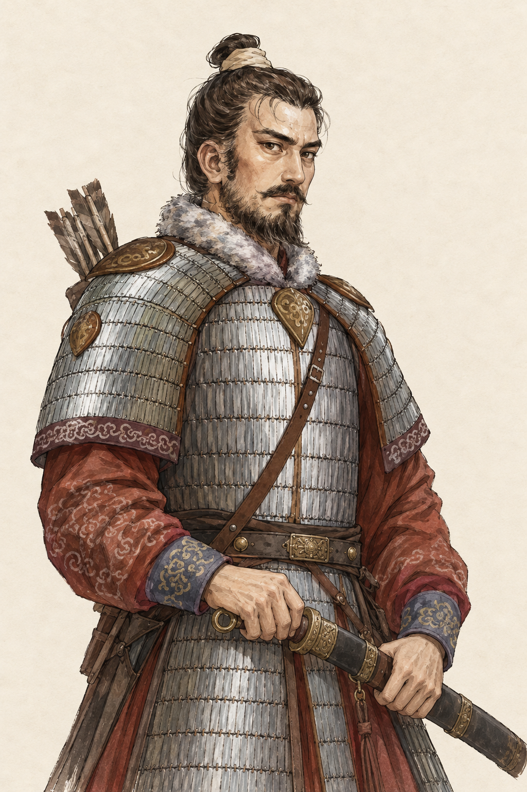
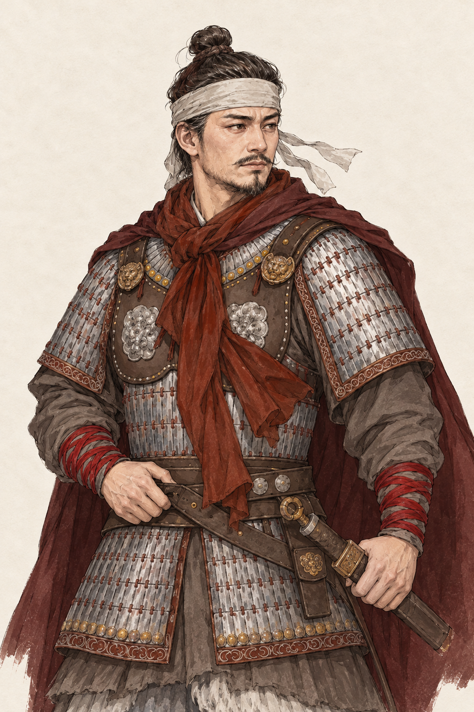
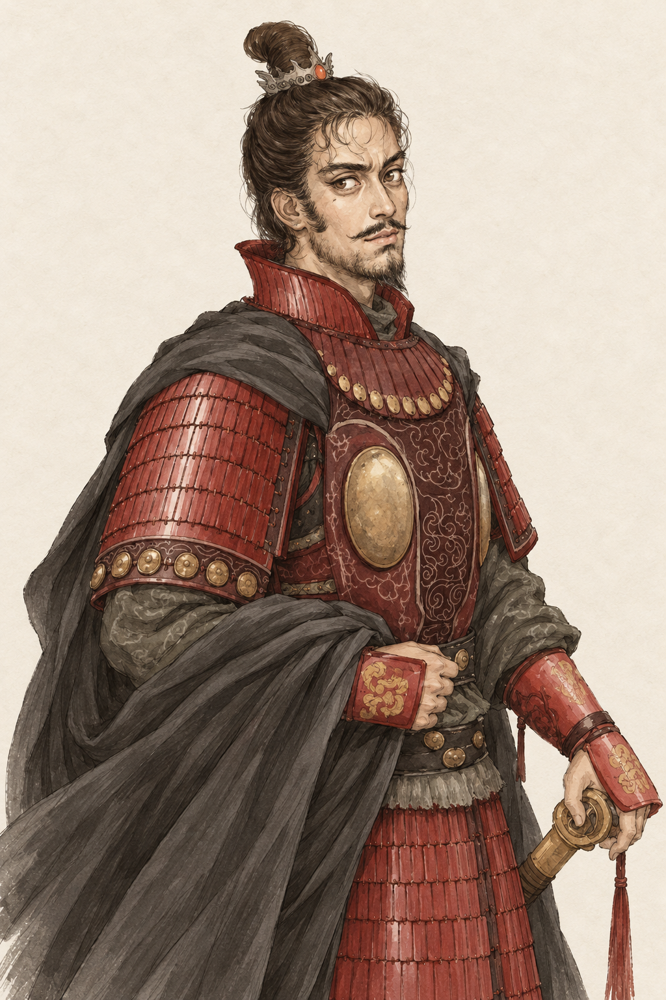
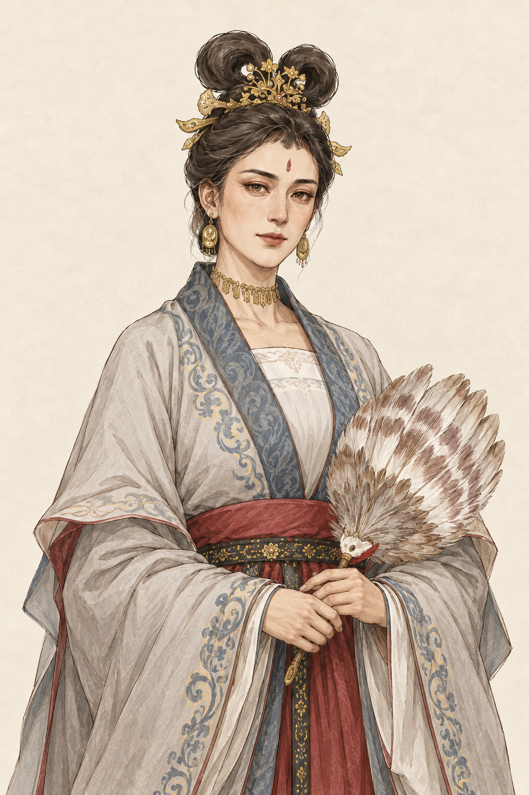
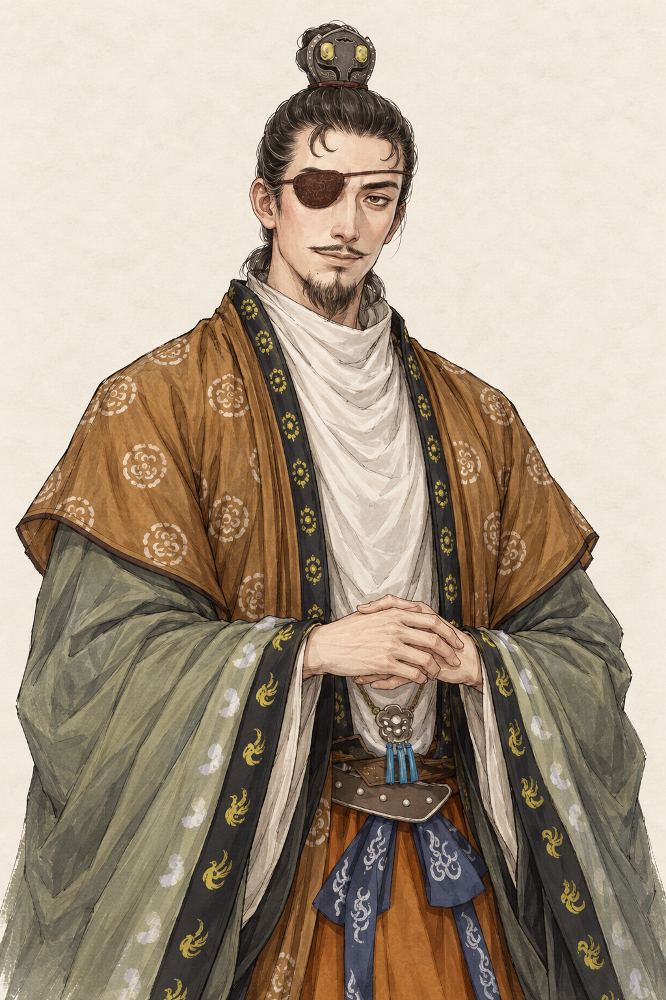

# 第三批历史人物肖像预期图

类型：美术目标与生成素材记录。范围：慕容绍宗、韦孝宽、宇文护、娄昭君、萧绎。
状态：2026-10-18 五张预期图已获用户确认并按要求接入游戏；新增换装、合成及游戏界面待用户人工验收。下方保留预览阶段的来源与验证记录。
核对依据：用户五张参考图、用户明确将第 5 位更正为萧绎并保留眼罩、游戏 `expandedPeople.ts`／`lifespans.ts`／`characters.ts`／`relationships.ts`／`portraitProfiles.ts`，以及上一批已确认的线描淡彩风格。使用内置 image_gen，未使用 CLI/API 回退。

## 五张预期图

五张均为 1024×1536 PNG，统一浅纸底、细线描淡彩的 2:3 半身构图。原图中的地图、题字、水印与战场背景不进入新图。面貌、服饰形制、配色、兵器与姿态为参考图基础上的艺术演绎，不声称为确证容貌或装备复原。

| 人物 | 按游戏 546 年开局呈现 | 参考特征与调整 | 预期图 |
| --- | --- | --- | --- |
| 慕容绍宗 | 约 45 岁，东魏将领 | 银色札甲、浅毛领、赭红袖、发髻与中短须；侧身姿态收为双眼可见的半侧面，兵器收至腰侧 | [原图](murong-shaozong.png) |
| 韦孝宽 | 约 37 岁，西魏将领，镇守玉壁 | 灰白额巾、短须、银甲、深红围巾与束腕；移除血迹、伤势暗示、尖刺和背景破旗，改为平静持佩剑 | [原图](wei-xiaokuan.png) |
| 宇文护 | 约 33 岁，西魏将领、宇文泰之侄 | 卷曲额发、窄须、红甲、铜色胸饰与墨灰披风；收敛夸张面部与饰件，保持警觉自信 | [原图](yuwen-hu.png) |
| 娄昭君 | 约 45 岁，渤海王妃、高欢的配偶 | 双环髻、金饰、灰白蓝缘宽袖、红束腰与羽扇；增加成熟感、简化头饰，不使用后世凤冠或太后礼制 | [原图](lou-zhaojun.png) |
| 萧绎 | 约 38 岁，湘东王、江州刺史 | 按用户更正制作萧绎；保留图 5 的单眼眼罩、赭褐披衣、灰绿袖与拱手，坐姿改为系列站立半身 | [原图](xiao-yi.png) |

## 史料与艺术边界

- 慕容绍宗：[《北齐书》卷二十](https://zh.wikisource.org/wiki/北齊書/卷20)记其仪容、寡言与谋略，并载东魏时期军政经历。本图据此收敛为沉稳的中年将领；具体甲胄、毛领、须发与箭囊主要来自用户图 1。
- 韦孝宽：[《周书》卷三十一](https://zh.wikisource.org/wiki/周書/卷31)用于核对人物、镇守玉壁与大统十二年的时序，并参照其沉静、敏察的性情描写。图 2 的血迹及包扎不作为固定健康状态；新图的额巾只作衣装，未给人物新增负伤或疾病。
- 宇文护：[《周书》卷十一](https://zh.wikisource.org/wiki/周書/卷11)用于核对宇文泰之侄的亲缘、开局前后将军任职与后来的执政时序。红甲、铜饰、卷发及面貌是参考图的美术取舍，不将后来的权臣身份或帝王冠服提前带入 546 年。
- 娄昭君：[《北齐书》卷九](https://zh.wikisource.org/wiki/北齊書/卷9)用于核对配偶、王妃身份及参与家政、军政谋划的记述。以成熟、从容的贵妇形象表现，保留参考图的首饰、羽扇和衣色；具体发式、金饰组合不声称为墓葬实物复原，不把后来的皇太后身份提前带入。
- 萧绎：[《梁书》卷五](https://zh.wikisource.org/wiki/梁書/卷05)用于核对生年、湘东王及 540 年任江州刺史、547 年转荆州刺史的时序。用户已明确将名单中的“萧纲”更正为“萧绎”。眼罩保留于画面左侧，依据用户参考图及明确选择；既有外观配置未据现代绘图推定眼疾侧别，本轮也不将眼罩侧别、形制及纹样当作历史确证或写入健康数据。
- 用户提供的现代参考图原样保存在 `references/`，未提供原作者及原始来源。系列风格只参照[已确认的高欢预期图](../historical-five-546-v1/gao-huan.png)的线描、设色和材质，不复制其面貌、年龄、性别或衣冠。

## 生成与验收边界

完整实际提示词、参考映射与生成原件文件名保存于 [prompts.json](prompts.json)。选定原件保留在 Codex generated_images 目录，项目副本用于本轮预览。

本轮不修改生产肖像、世界数据、人物关系、职位、遗传参数、疾病或存档。后续接入需按每张新画面另行登记五官、眼罩遮挡、小头像及身份换装，不能复用旧底图坐标。原图目视不代替用户审美确认，未进行浏览器自动化或 UI 验收。

五张 PNG 的尺寸、全部块校验、生成原件与参考图副本一致性、97 个文档本地链接及提示词资源映射通过。本地游戏及五张新图均返回 HTTP 200；只读文件和 HTTP 检查不代表浏览器 UI 或玩法验收。本轮未改游戏代码，未执行构建、规则测试、长局或完整游戏回归。

## 确认后的接入

用户明确要求接入后，五张确认原件与四格换装、匹配去五官底稿共 20 张 PNG 进入共用肖像系统。娄昭君按女性登记，萧绎按画面左侧眼罩登记遮挡，固定被覆盖的眉眼采样；可见五官、实际年龄和健康层继续沿用既有规则。三位将领开局按当前游戏身份显示常服，实际领军后使用已确认的甲胄原件，不据服饰修改职位或军队。生产素材、完整实际提示词及人工入口见[第三批生产说明](../../../../public/art/portraits/painted-c/historical-third-v1/README.md)。预期图确认不代表新增换装或 UI 已验收。
