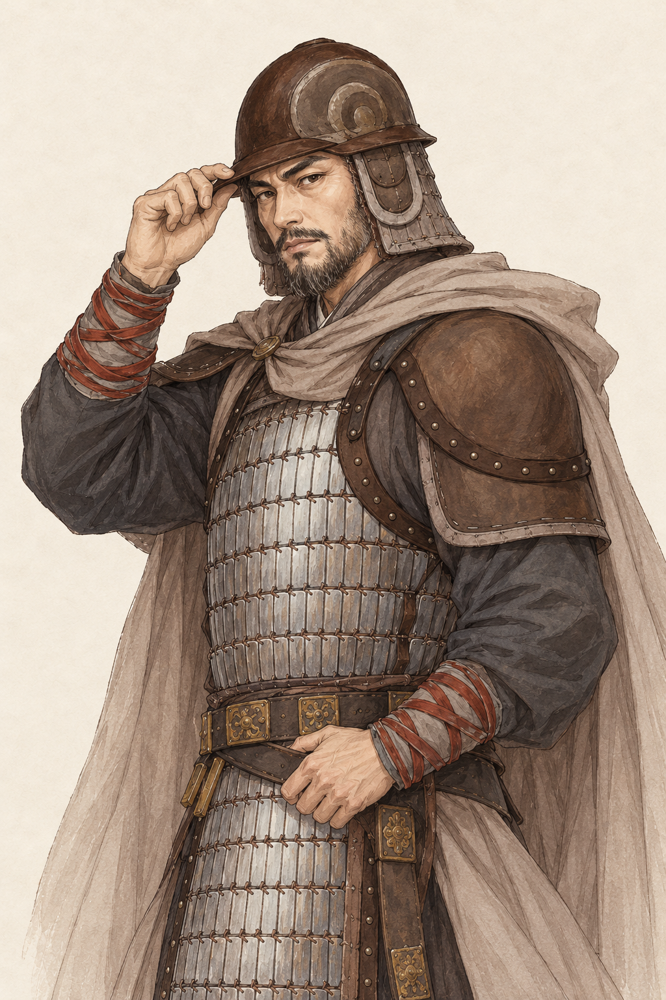
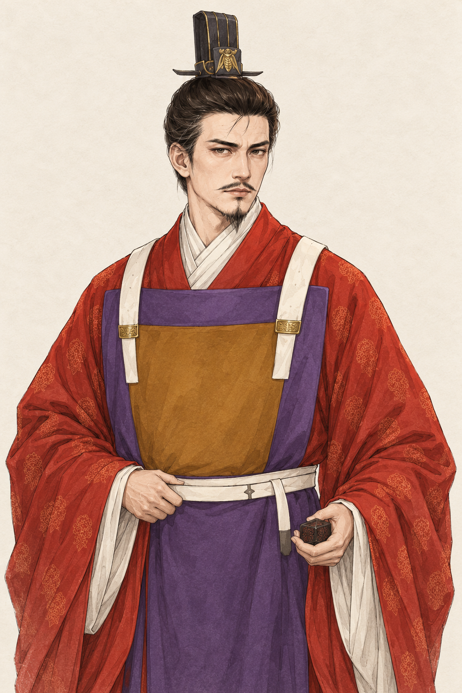
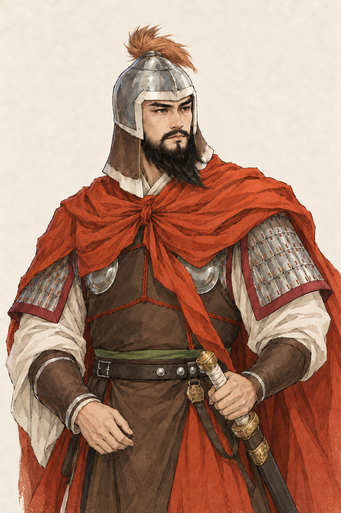
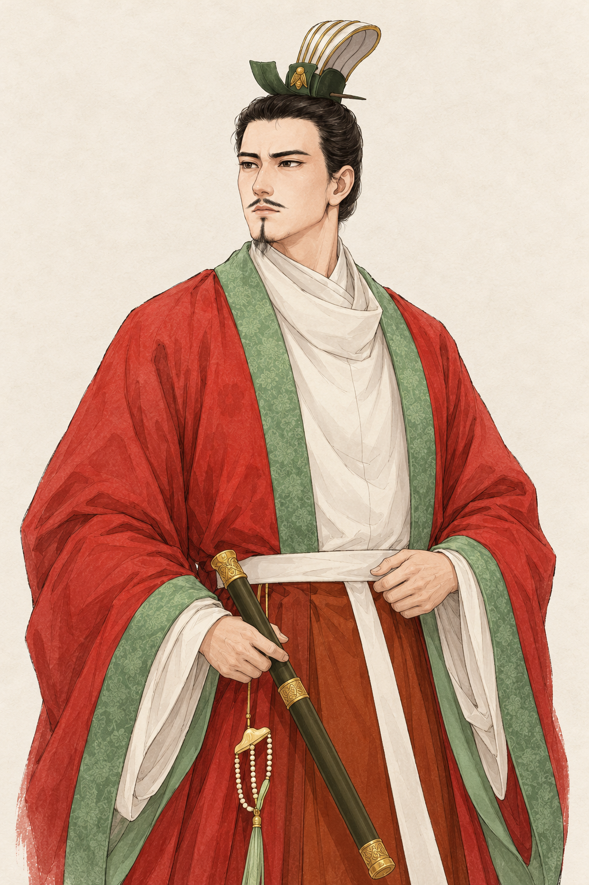
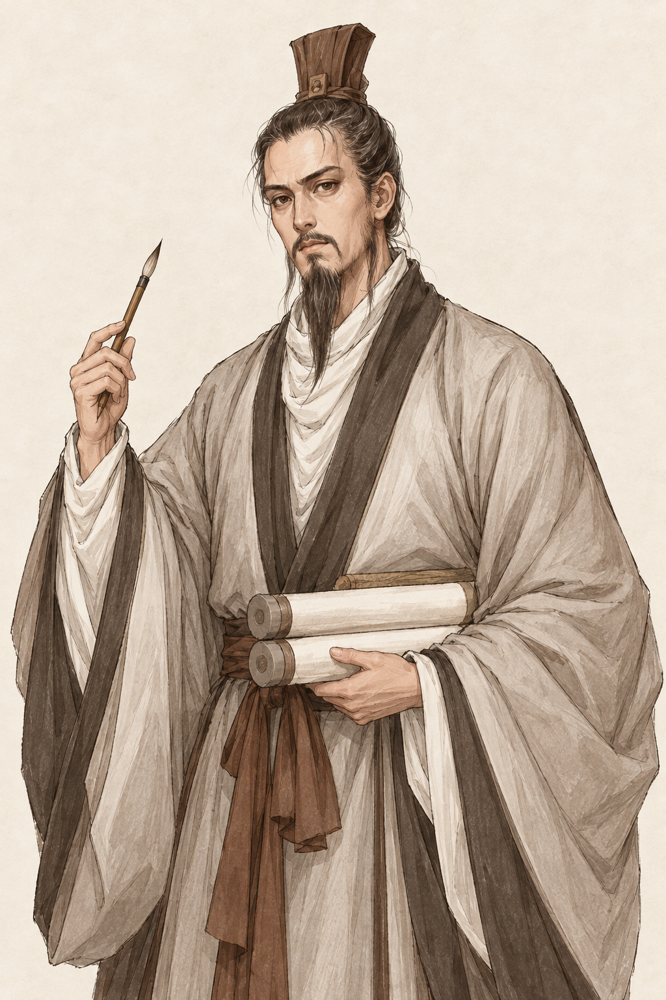
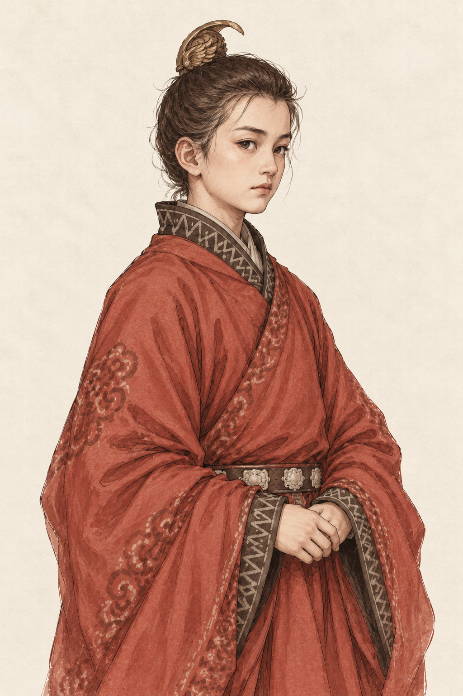
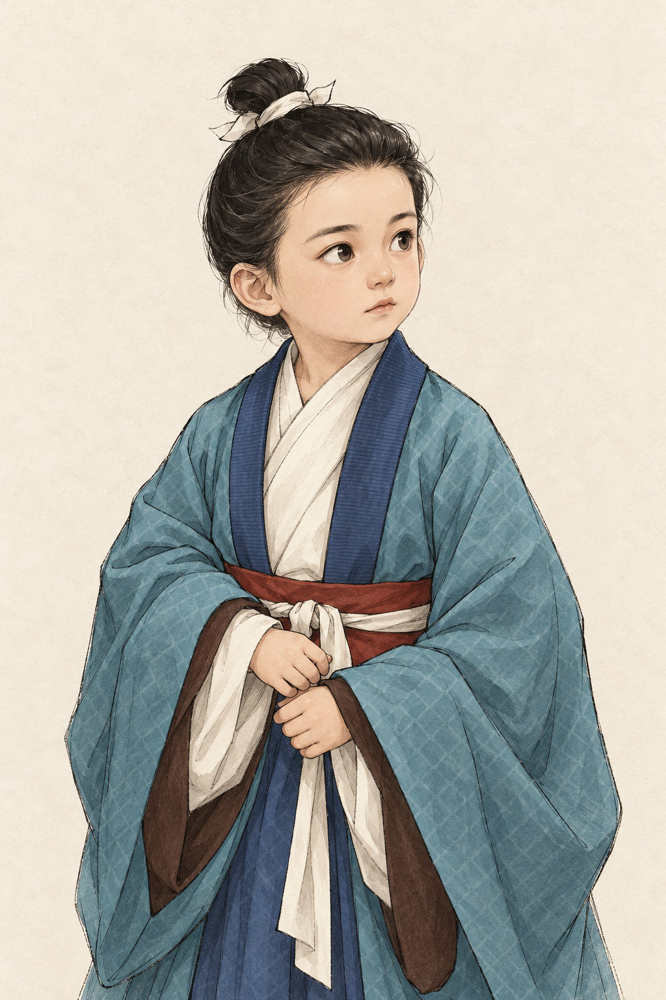

# 西魏七位人物立绘预期图

类型：美术目标与生成素材记录。范围：李弼、独孤信、杨忠、元宝炬、苏绰、宇文毓、宇文觉。
状态：2026-10-18，用户确认七张预期图并要求接入，已进入共用肖像流程；新增换装、成长素材及游戏界面待人工验收。下方保留预览阶段的来源与验证记录。
核对依据：用户七张参考图，游戏 `characters.ts`、`expandedPeople.ts`、`lifespans.ts`、`portraitProfiles.ts`，前几批已确认的线描淡彩风格及下列史料。生成使用内置 image_gen。

## 七张预期图

统一 1024×1536、2:3 半身立绘，浅纸底、细线描和淡彩。侧身人物收为双眼可见的半侧面，冠顶、持物与双手保留画内空间，去除地图、题字、水印、界面及战场背景。年龄均按游戏 546 年开局及当前生年数据计算，未补造具体生日；表中身份指历史题材方向，不据服饰授予游戏官职。

| 人物 | 游戏开局约龄 | 保留与调整 | 预期图 |
| --- | --- | --- | --- |
| 李弼 | 52 岁 | 棕色低盔、银灰札甲、灰褐披风与扶盔手势；转半侧正面，增加中年须发与成熟感 | [李弼](li-bi.png) |
| 独孤信 | 43 岁 | 红袍、紫色前襟、赭色胸片、白色带饰与高冠；保留清俊仪容，按壮年呈现 | [独孤信](dugu-xin.png) |
| 杨忠 | 39 岁 | 银盔、小羽饰、浓须与赭红披风；收敛战斗姿势，佩剑入鞘，不提前使用隋代帝王身份 | [杨忠](yang-zhong.png) |
| 元宝炬 | 39 岁 | 朱红宽袍、青绿缘饰、白色内衬、通天冠方向冠形与深绿佩剑；双手收近，通天冠不加冕旒 | [元宝炬](yuan-baoju.png) |
| 苏绰 | 48 岁 | 灰白素袍、细长须、执笔与两卷文书；冠形缩至完整可见，保持成熟清简文士气质 | [苏绰](su-chuo.png) |
| 宇文毓 | 12 岁 | 赭红纹袍、深色几何缘饰与简化曲形发簪；改为少年五官与身形，不前置成年官冠、胡须或帝位 | [宇文毓](yuwen-yu.png) |
| 宇文觉 | 4 岁 | 青蓝纹袍、靛色领缘、红腰带与白系带；按幼童脸型和手部呈现，去成年高冠及长剑 | [宇文觉](yuwen-jue.png) |

## 史料与演绎边界

- 李弼：[《周书》卷十五](https://zh.wikisource.org/wiki/周書/卷15)核对其军旅经历、沉雄性情及开局前后任职。棕盔、披风、须形和扶盔手势来自用户图 1，未据图制造人物当日伤势。
- 独孤信：[《周书》卷十六](https://zh.wikisource.org/wiki/周書/卷16)有仪容、修饰及秦州经历的记述。仅作为清俊整肃的总体方向，具体五官、红紫朝服和冠饰参考用户图 2，不声称为确证礼服复原，也不前置后来周、隋的名号。
- 杨忠：[《周书》卷十九](https://zh.wikisource.org/wiki/周書/卷19)记其髭髯、魁伟形貌和西魏军旅经历。以浓须、壮年将领气质表现，具体盔羽、甲胄、佩剑及披风配色来自用户图 3，不使用后来隋朝追尊的帝王形象。
- 元宝炬：[《北史》卷五](https://zh.wikisource.org/wiki/北史/卷005)核对西魏在位及大统年间背景。冠形沿用户图 4 作通天冠方向的艺术演绎，不加冕板或左右珠帘，不以画面暗示游戏中不存在的实际执政权限。
- 苏绰：[《周书》卷二十三](https://zh.wikisource.org/wiki/周書/卷23)核对文案、计帐、户籍与六条行政背景。灰白袍、执笔、卷轴和须形来自用户图 5；默认健康立绘不预告或强制其历史卒年。
- 宇文毓：[《周书》卷四](https://zh.wikisource.org/wiki/周書/卷04)记其生于永熙三年；游戏生年为 534，开局约 12 岁。取用户图 6 的衣色和发饰方向，面貌及体态调整为少年，不把后来宁都郡公、刺史或帝王身份提前带入。
- 宇文觉：[《周书》卷三](https://zh.wikisource.org/wiki/周書/卷03)记其生于大统八年；游戏生年为 542，开局约 4 岁。用户图 7 的服色用于幼童版本，成年长剑和高冠不用于幼童立绘，不提前表现后来的受禅或君位。

七张现代参考图原样保存在 `references/`，用户未提供原作者及原始链接。系列风格只参照[已确认高欢预期图](../historical-five-546-v1/gao-huan.png)的线描、设色与纸面材质，不复制其五官和服饰。所有面貌、头饰及装备均含艺术演绎，不能视为真实容貌、精确装备或身份权限的史证。

## 生成与验收边界

完整实际提示词、参考映射及生成原件文件名保存在 [prompts.json](prompts.json)。杨忠首版盔羽贴近画面上缘，使用内置 image_gen 缩短羽饰并补足留白，修正提示词一并保留。生成原件保留，项目保存选定原件的逐字节副本；未对原图做离线裁切或绘改。

本轮交付为待确认的立绘预览，未修改生产肖像、人物年龄、遗传、关系、职位、健康或存档。后续接入需按新画面登记五官和头像，分别处理身份换装及两位未成年人的成长阶段；不能复用旧画面的锚点或将幼童形象固定用于成年期。素材目视与文件检查不代替用户美术确认，未进行浏览器自动化或 UI 验收。

七张 PNG 的尺寸、全部块校验、选定生成原件及七张来图副本一致性、102 个文档本地链接和提示词映射检查通过。七张预览图、本地游戏入口、入口脚本、内容包和模拟 Worker 均返回 HTTP 200。此为文件与启动模块可读检查，不代表界面或玩法验收；本轮未改游戏代码，未运行构建、规则测试、长局或完整游戏回归。

## 确认后的接入

七张原件与换装、匹配去五官底稿、宇文觉少年阶段共 30 张 PNG 接入共用人物、消息／事件、小头像和地图流程。宇文毓按少年／成年切换，宇文觉按幼童／少年／成年切换，16 岁后服饰按实际身份选择；年龄取世界状态，已故者保留去世年龄。独孤信开局领军显示甲胄，李弼和杨忠当前未领军显示常服，未以服饰改写职位。完整实际提示词、视觉阶段阈值与人工入口见[生产说明](../../../../public/art/portraits/painted-c/historical-west-seven-v1/README.md)。确认原图不代表新增换装、成长或界面已验收。
