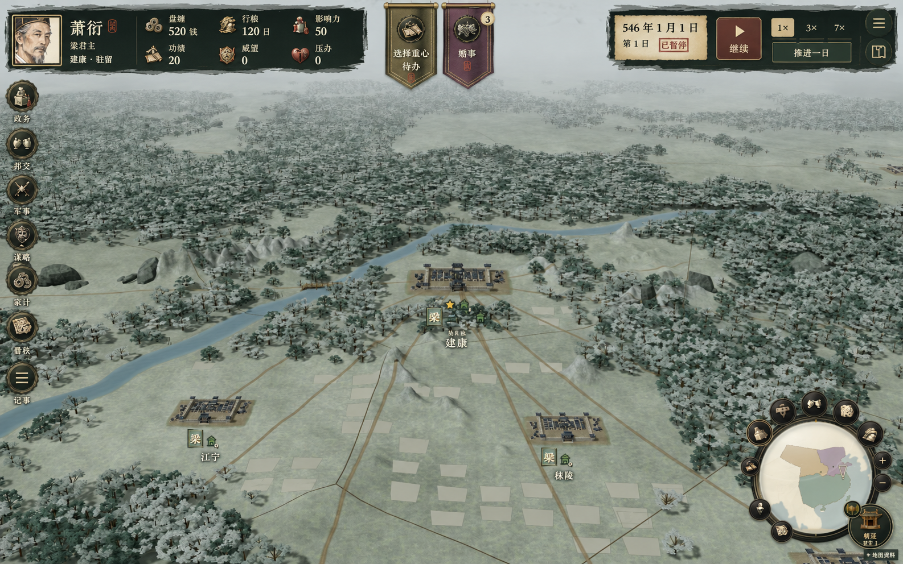
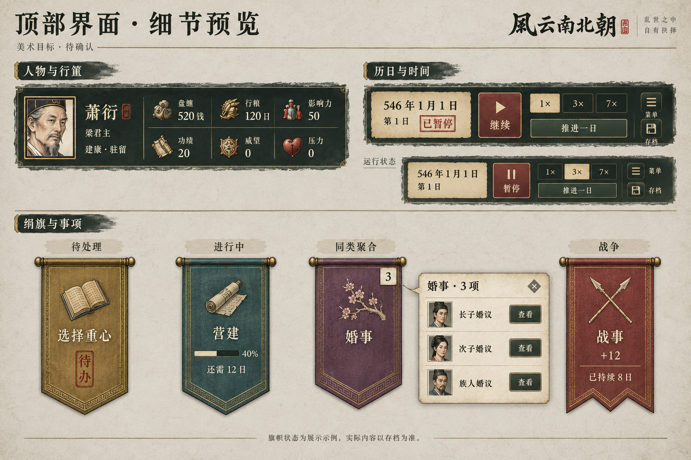

# 顶部界面美术目标

类型：已确认的美术目标与实施核对。
范围：人物与个人资源栏、日期时间控制、待办及进行中事项旗帜。
状态：2026-10-13 用户确认实施，已接入正式本地游戏；待用户最终审美验收。
依据：2026-10-13 本地暂停存档界面，以及已落地的左侧窗口／人物详情新规范。

## 设计方向

- 人物与个人资源采用紧凑墨绿底、毛边、细旧金线；保留肖像、身份、驻地和六项真实个人资源，避免误读为国家公库。肖像仍进入人物详情，资源分解仍可查看。
- 历日采用浅纸日期签，暂停以朱砂印记提示；继续／暂停为明确的独立主按钮，1×／3×／7× 保留单选态，推进一日、菜单和存档独立可达。基础操作不增加悬浮说明。
- 中央旗帜采用轻薄绢纹、低饱和类别色、短横杆和细绣边，移除重铜牌底座。单项直达，同类多项展开纸笺清单；完成后移除。等待事项不画假进度。
- 进行中事项保留真实进度和剩余／截止日期；战争旗帜最前，使用暗朱砂与独立旗形。数量增多时压缩间距、适度叠排，保留每旗点击露出区域，极端密度分行，不横向滚动。无事项时完全露出地图。
- 三组组件各自独立，不铺通栏黑底；左右高度不强行一致。弹窗仍高于中央旗帜，资源／时间保持原有独立层级。新事项短暂落入，平时不持续晃动；支持减少动态效果。

## 交付与边界

整体图用于看摆放关系；组件细节图为进一步细化的控件与旗帜材质方向，以细节图为准。生成图对外围导航存在再绘，外围导航并非改造提案；实施时保留现有地图与导航。

整体图以实际存档的「选择重心」「婚事 3 项」呈现；细节图中的其他旗帜仅说明视觉状态，不表示存档已有事项。地图、左侧导航和小地图不在本轮改造范围。

由内置 image_gen 生成，完整提示词见本目录 `prompts.md`。生成图用于确认材质、层级和布局；文字、热区及真实状态将在获准实施后按代码精确实现。

## 2026-10-13 实施与验证

- 人物身份、资源、历日、绢旗、同类事项纸笺均已接入；主按钮采用朱砂折角，速度采用纸签选中态，菜单与存档去掉铜牌底座。真实人物肖像和具体权限保留。
- 原图资源和书册／卷轴／花枝／兵器插画直接作为图集裁切使用；墨纸边框与绢纹采用可伸缩矢量构造，适配真实文字长度与事项数量，不把生成图中的数字烘焙进界面。
- 只有真实进度才显示进度条；未知期限继续显示待办／暂缓，明确区分剩余工期、预计时间与截止期限。暂停保留待恢复速度的选中提示，时间命令和存档结构未改变。
- 浏览器检查 1600×1000、900×900：三组组件不碰撞；婚事清单显示三位真实关联人物并能直达萧纪议婚草稿；菜单与存档页面打开后时间按钮正确锁定，关闭后恢复。未确认婚姻或推进日期，仍为萧衍 546 年 1 月 1 日暂停状态。
- 局部测试 `topHud.test.tsx`、`flagLayout.test.ts`、`ongoing.test.ts` 共 23 项通过，覆盖资源／身份读取、时间锁定、等待无假进度、行旅进度、事项投影和密集排旗；`npm run build` 通过，含 854 项发布资源核验。未执行全量或长局回归。
- 当前存档没有进行中工程和战争，相关计时与投影由局部测试／代码核对覆盖，未冒充实机战争验证。运行速度状态由组件渲染测试覆盖，实机始终暂停。
- 实机：[整体](../../images/top-hud/overview.png)、[事项纸笺](../../images/top-hud/pending-list.png)。目标图是放大的组件设计板，实际组件按游戏 HUD 尺度排布，最终审美仍由用户确认。

### 顶部比例收紧

用户反馈三组组件过大后，将左右面板从 108px 收至 84px，宽度从 500／474px 收至 420／380px；旗帜高度从 132px 收至 104px，最大间距从 84px 收至 64px。姓名为 16px、资源和日期为 14px、操作为 11–13px、辅助文字为 10–11px，头像与插画同步缩小。保留原材质、边框及操作语义，并上移左侧导航以减少顶部占用。

1600×1000、900×900 实机检查无横向溢出或组件碰撞；已更新整体图，事项纸笺截图保留上轮记录。密集排旗的 2 项局部测试及 `npm run build` 通过。本轮只改比例与排布，未推进时间，最终比例待用户确认。

### 移除旗帜悬浮提示

按用户截图反馈，移除战争及其他单项事项旗帜的悬浮／聚焦说明框，保留旗面状态、可访问名称、点击直达及同类聚合清单。未改资源说明或其他界面的提示。顶部组件 4 项局部测试与构建通过；本次未另做浏览器验收。

## 2026-10-18 用户新参考覆盖

用户提供《魏晋南北朝水墨策略界面》并要求四角界面完整对齐。本目录 2026-10-13 的人物匾、日期签与中央事项摆放已由新参考覆盖：人物采用雕木鎏金墨绿匾，时间采用卷轴，事项挂于右上卷轴下；左侧操作栏和右下小地图同时换肤，朝廷继续复用当前图标。参考原件作为 [运行图集](../../../public/art/interface/reference-hud.png) 保存，原图不等于实机截图；实际内容由组件绘制，详见 [实施记录](../../实施记录/迭代整合进度.md#2026-10-18-四角界面按用户水墨参考换肤)。本轮仅完成代码及非 UI 验证，视觉与交互效果待用户人工验收。
